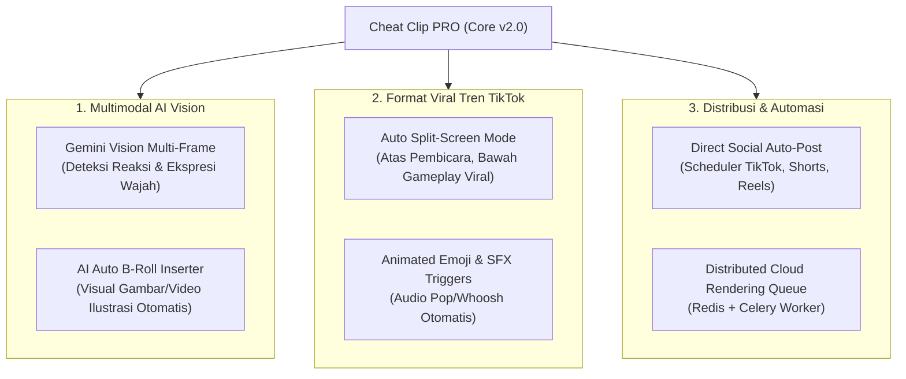

# 💡 Brainstorming, Riset & Inovasi — Cheat Clip PRO

Dokumen ini berisi kumpulan **eksplorasi ide, analisis potensi inovasi, riset teknologi masa depan, dan strategi monetisasi** untuk membawa Cheat Clip PRO dari sekadar alat bantu klip video lokal menjadi ekosistem pembuatan konten micro-video terdepan.

---

## 🎯 1. Peluang Pasar & Tren Konten Masa Depan

Format video vertikal pendek (*short-form video*) di TikTok, Instagram Reels, dan YouTube Shorts kini menjadi kanal utama penemuan audiens (*organic reach*). Namun, tantangan terbesar para kreator dan agensi adalah:
1. **Audience Retention Deficit**: Penonton meninggalkan video jika tidak ada rangsangan visual (*hook*) dalam **3 detik pertama**.
2. **Kebutuhan Volume Tinggi**: Algoritma media sosial menuntut konsistensi unggah 2–5 video per hari untuk pertumbuhan optimal.
3. **Keterbatasan Biaya Agensi**: Mempekerjakan video editor manusia untuk memotong 30 video per bulan membutuhkan anggaran jutaan rupiah per klien.

Cheat Clip PRO berada di posisi strategis untuk menjadi solusi **AI Co-Editor Mandiri** dengan efisiensi biaya mendekati nol.

---

## 🚀 2. Brainstorming Fitur Baru & Inovasi Generasi Berikutnya

Berikut adalah pemetaan ide fitur inovatif yang dapat dikembangkan secara bertahap:



---

### Inovasi 1: Multimodal AI Vision dengan Gemini (Tidak Hanya Transkrip Teks)
- **Konsep**: Saat ini seleksi momen viral hanya mengandalkan transkrip audio dan heatmap penonton. Dengan model multimodal Google Gemini terbaru, sistem dapat mengambil *keyframe* video setiap beberapa detik.
- **Keunggulan**:
  - Mampu mendeteksi momen visual dramatis (misal: reaksi terkejut host, gerakan ekspresif, grafik presentasi menarik, atau gol/clutch dalam gameplay).
  - Memberikan skor viralitas gabungan (*Visual Excitement Score + Spoken Dialogue Score*).

---

### Inovasi 2: Auto Split-Screen Mode (Atas Pembicara, Bawah Gameplay Viral)
- **Konsep**: Tren video pendek di TikTok/Shorts sering menggabungkan video podcast di bagian atas frame (1:1 atau 4:5) dan rekaman gameplay adiktif di bagian bawah (Subway Surfers, Minecraft Parkour, atau video kinetic sand/satisfying).
- **Implementasi**:
  - Preset layout di Tab 03: `Split 50/50` atau `PiP (Picture in Picture)`.
  - Folder lokal berisi video looping background gameplay bebas royalti yang otomatis di-mix oleh FFmpeg atau Canvas WebCodecs.
  - Sangat efektif melipatgandakan *watch time* pada target audiens usia muda.

---

### Inovasi 3: Subtitle Animasi Gaya Hormozi / MrBeast + Dynamic Emojis
- **Konsep**: Gaya subjudul modern tidak hanya mewarnai kata, tetapi memantulkan animasi (*bounce / zoom-in*), menambahkan emoji relevan secara otomatis, dan memicu efek suara (*sound effects*).
- **Implementasi**:
  - Deteksi kata kunci emosional: Kata "uang" -> muncul emoji `💸`, kata "terkejut" -> muncul emoji `😱`, kata "api" -> muncul emoji `🔥`.
  - Auto-insert sound effect: Suara *whoosh* saat subtitle berganti kalimat, suara *ding* atau *cash register* saat angka penting disebut.

---

### Inovasi 4: AI Auto B-Roll & Visual Context Inserter
- **Konsep**: Ketika pembicara menyebutkan konsep abstrak ("Misalnya tahun 2008 saat krisis ekonomi..."), video sering terasa membosankan jika hanya menampilkan kepala orang berbicara (*talking head*).
- **Implementasi**:
  - Gemini AI mengidentifikasi entitas atau topik yang butuh ilustrasi visual.
  - Sistem secara otomatis mengambil cuplikan video stok bebas royalti (via Pexels / Pixabay API) dan menumpukkannya (*overlay cutaway*) selama 2-4 detik di atas klip.

---

### Inovasi 5: Direct Auto-Publisher & Schedule ke TikTok, Reels, dan Shorts
- **Konsep**: Menghemat waktu kreator dari proses manual memindahkan file hasil render ke HP lalu mengunggahnya satu per satu.
- **Implementasi**:
  - Integrasi OAuth resmi dengan TikTok Content Posting API, YouTube Data API v3, dan Meta Graph API for Instagram.
  - Pengguna dapat menentukan jadwal: "Unggah 3 klip ini pada jam 12:00, 16:00, dan 19:00 WIB".
  - Judul, caption, dan hashtag yang digenerate Gemini langsung terisi otomatis pada draft posting.

---

### Inovasi 6: Speaker Diarization & Two-Person Side-by-Side Crop
- **Konsep**: Pada podcast dengan 2 pembicara (misal host di kiri, bintang tamu di kanan):
  - Saat Host berbicara, kamera vertikal fokus ke Host.
  - Saat Tamu berbicara, kamera vertikal beralih ke Tamu.
  - Saat keduanya berinteraksi sengit, frame otomatis terbagi dua (*stacked vertical: atas dan bawah*).
- **Implementasi**:
  - Integrasi Whisper Diarization (PyAnnote Audio / NeMo) untuk membedakan *Speaker 0* dan *Speaker 1*.
  - Koordinat bounding box wajah OpenCV dipetakan secara dinamis berdasarkan stempel waktu pembicara aktif.

---

## 💰 3. Potensi Model Bisnis & Monetisasi (SaaS & Desktop)

```text
┌─────────────────────────────────────────────────────────────────────────────┐
│                       STRATEGI MONETISASI TIERED                            │
├──────────────────────────┬────────────────────────────┬─────────────────────┤
│ TIER 1: FREE / OPEN      │ TIER 2: PRO DESKTOP        │ TIER 3: AGENCY CLOUD│
│ (Desktop Open Source)    │ (Lisensi Lifetime / .exe)  │ (Monthly SaaS)      │
├──────────────────────────┼────────────────────────────┼─────────────────────┤
│ • Client GPU Rendering   │ • Tanpa watermark          │ • Unlimited Cloud   │
│ • Input Sendiri API Key  │ • Akses font viral premium │   Rendering Worker  │
│ • Single Clip Processing │ • Multi-Key Rolling Manager│ • Multi-seat Team   │
│ • Komunitas & Self-host  │ • Export Batch 1-Click     │ • Direct Auto-Post  │
│                          │ • Dukungan Offline Penuh   │ • Prioritas Support │
└──────────────────────────┴────────────────────────────┴─────────────────────┘
```

1. **Freemium Bring-Your-Own-Key (BYOK)**:
   - Versi gratis memungkinkan siapapun menggunakan aplikasi dengan memasukkan Gemini API key gratis mereka sendiri.
   - Tanpa biaya server bagi pemilik produk.
2. **Paket Desktop Pro (One-Time License / Gumroad / Lynk.id)**:
   - Menjual installer mandiri (.exe) siap pakai dengan asset font lengkap, template preset BGM, dan preset layout split-screen.
3. **Paket Agensi / Studio (B2B)**:
   - Menyediakan fitur *White-Label* (logo agensi), integrasi Google Drive tim untuk memproses ratusan video rekaman webinar/zoom per bulan secara batch.

---

## 📊 4. Analisis SWOT Cheat Clip PRO

### Strengths (Kekuatan)
- **Arsitektur Client-First GPU WebCodecs**: Mengeliminasi tagihan cloud GPU server.
- **Multi-Key Rolling API**: Mengatasi batasan kuota gratis Gemini dengan rotasi cerdas hingga 10 key.
- **Portabilitas Tinggi**: Tersedia sebagai Web App dan Desktop Executable (.exe) offline-ready.
- **Desain UI Cyberpunk Blue Neon**: Tampilan visual yang khas, tajam, dan disukai kreator tech/digital.

### Weaknesses (Kelemahan Saat Ini)
- **Ketergantungan pada Transkrip**: Belum menganalisis video berbasis visual kamera langsung jika audio tidak memiliki percakapan vokal.
- **Dukungan Bahasa**: Saat ini difokuskan pada Bahasa Indonesia dan Inggris.

### Opportunities (Peluang)
- **Tingginya Permintaan Konten Pendek**: Seluruh kreator dan korporasi kini membutuhkan ribuan klip per tahun.
- **Peningkatan Kapabilitas Model Gemini**: Model Flash Google semakin murah, cepat, dan memiliki context window hingga 1-2 juta token untuk video berjam-jam.

### Threats (Tantangan)
- **Perubahan Ekstraktor YouTube**: Pembaruan sistem antibot YouTube yang berkala mengharuskan pembaruan rutin pada library `yt-dlp`.
- **Kompetitor SaaS Bermodal Besar** (seperti Opus Clip, Klap, Munch): Membutuhkan diferensiasi fokus pada kemudahan eksekusi lokal tanpa biaya langganan bulanan mahal.
