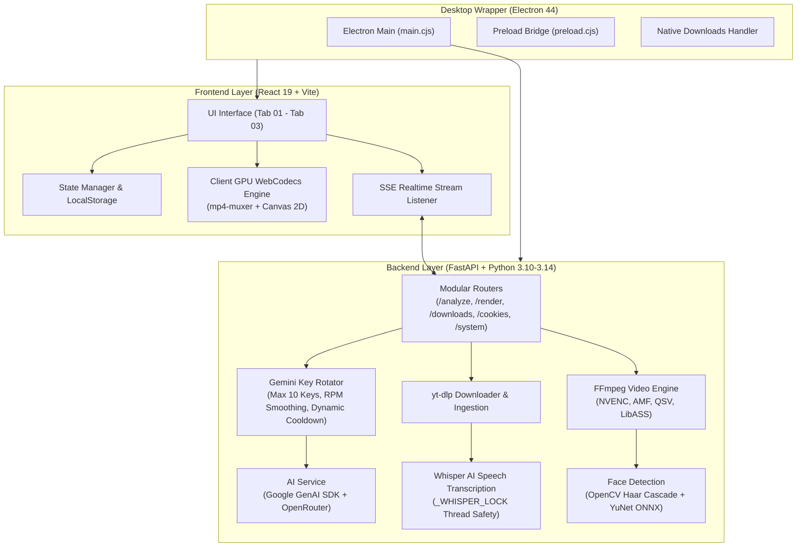
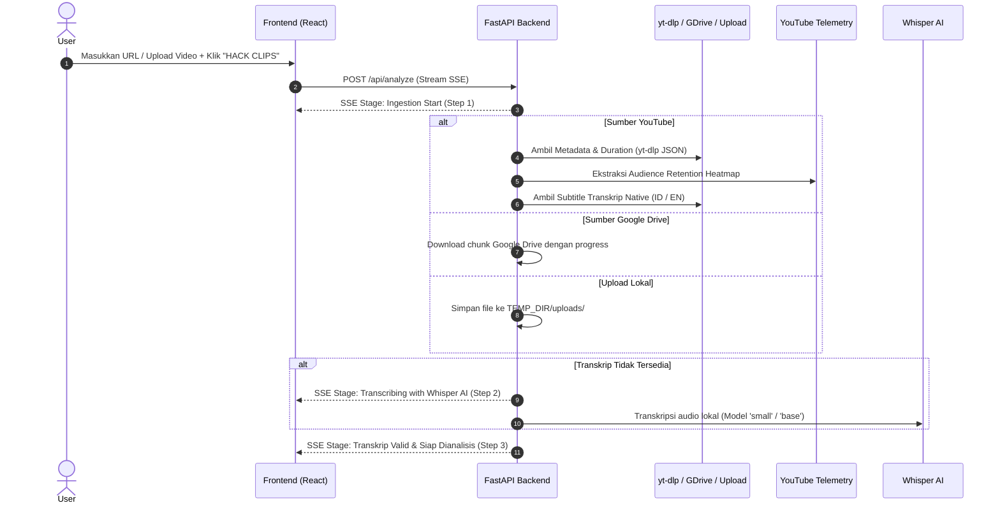
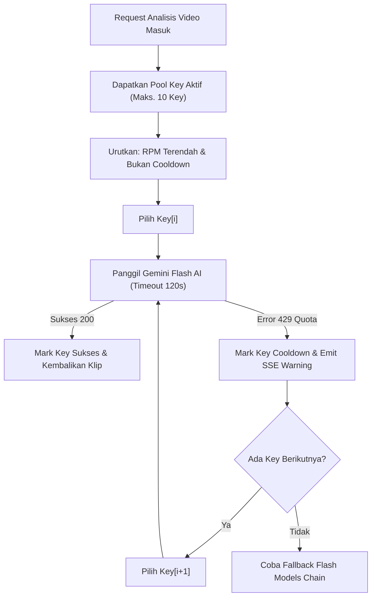
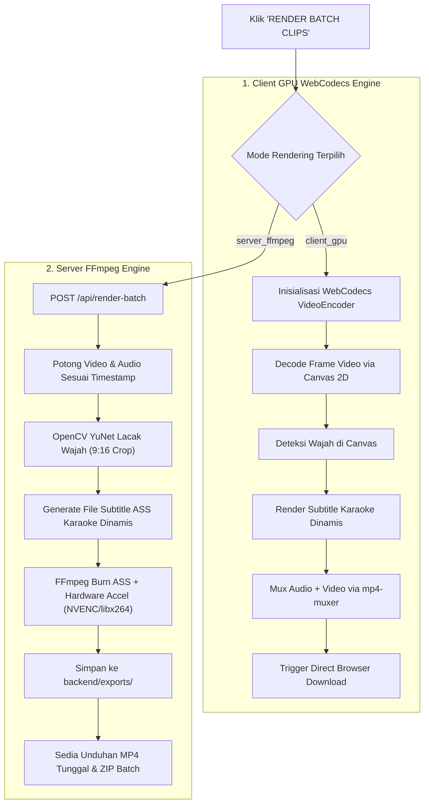

# 🏗️ Panduan Eksekusi Struktural — Cheat Clip PRO

Dokumen ini adalah **pedoman teknis dan struktural operasional** terlengkap untuk memahami, menjalankan, mengembangkan, dan memelihara sistem Cheat Clip PRO secara end-to-end.

---

## 🧭 Diagram Arsitektur Sistem Menyeluruh



---

## 📋 Fase 1: Bootstrapping & Resolusi Lingkungan

Sistem Cheat Clip PRO dirancang untuk berjalan pada dua target runtime:
1. **Developer / Web Server Mode**: Menjalankan Vite dev server (`:5173`) dan FastAPI Uvicorn (`:8000`) secara bersamaan.
2. **Desktop Standalone Mode (`.exe`)**: Electron membungkus frontend statis yang telah dibuild (`dist/`) dan memicu proses backend mandiri (`cheat-clip-backend.exe`).

### 1.1 Inisialisasi Environment Variabel
Backend membaca konfigurasi dari file `backend/.env` (berdasarkan `backend/.env.template`):
```ini
HOST=127.0.0.1
PORT=8000
GEMINI_API_KEY=AIzaSy...           # Opsional jika dimasukkan via UI
ALLOWED_ORIGINS=http://localhost:5173,http://localhost:8000
TEMP_MAX_AGE_SECONDS=3600         # TTL file sementara (1 jam)
TEMP_STORAGE_QUOTA_GB=5.0         # Batas maksimal cache lokal (5 GB)
```

### 1.2 Deteksi FFmpeg Otomatis di Windows (`ensure_ffmpeg_in_path`)
File `backend/video_engine.py` secara otomatis memindai path instalasi FFmpeg dan yt-dlp pada sistem Windows tanpa memerlukan konfigurasi manual pengguna:
- `AppData\Local\Microsoft\WinGet\Packages\...`
- `scoop\apps\ffmpeg\current\bin`
- `C:\ffmpeg\bin` dan `C:\Program Files\ffmpeg\bin`
- Memverifikasi dukungan filter subtitle libass: `_ffmpeg_has_filter(bin, "subtitles")`.

---

## 📥 Fase 2: Ingestion & Ekstraksi Telemetri Video

Endpoint: `POST /api/analyze` (dengan respons streaming SSE `text/event-stream`).



### Validasi Bahasa Transkrip
- Cheat Clip PRO memberlakukan aturan validasi bahasa ketat di `backend/utils/text.py`.
- Transkrip harus terdeteksi sebagai **Bahasa Indonesia (`id`)** atau **Bahasa Inggris (`en`)**. Jika terdeteksi bahasa lain, proses akan dihentikan secara aman dengan pesan error yang ramah pengguna.

---

## 🧠 Fase 3: Gemini Rolling API & Deteksi Momen Viral

### 3.1 Manajemen Multi-Key Rotator (Maksimal 10 Key)
Komponen `GeminiKeyRotator` di `backend/services/key_rotator.py` mengelola antrean key pengguna dengan prinsip:
1. **Sliding-Window RPM Tracking**: Memonitor jumlah request per key dalam jendela 60 detik terakhir.
2. **Proactive Load Balancing**: Request selalu dialokasikan ke API key dengan jumlah RPM terendah.
3. **Dynamic Cooldown Escalation**:
   - Error 429 (Rate Limit): Cooldown bertahap 60s -> 120s -> 180s (maks 300s).
   - Error 503 (Server Busy): Cooldown singkat 5 detik.
   - Error 401/403 (Invalid Key): Cooldown 1 jam.



### 3.2 Prompting Spesialis Viral Clip
Prompt dikonstruksi secara dinamis dengan aturan:
- **Zero Translation Rule**: Menghasilkan 100% judul, caption, kutipan, dan ringkasan sesuai bahasa vokal asli video.
- **Third-Person Title Rule**: Menghilangkan kata ganti orang pertama (*aku, saya, gue, I, me*) agar klip tampak profesional saat diunggah oleh pihak ketiga (editor).
- **Retention Correlation**: Mengaitkan transkrip percakapan dengan titik lonjakan retensi (*heatmap peak*) untuk menghasilkan skor viralitas 1-100.

---

## ✂️ Fase 4: Kurasi Klip & Pre-Render Trimming

1. **State Selection Synchronization (Aturan AGENTS.md Rule 4)**:
   - Saat analisis AI selesai, seluruh klip yang dihasilkan **otomatis tercentang** (`markedClips[clip.id] = true`).
   - Mencegah tombol render di Tab 03 menjadi disabled secara tidak terduga.
2. **Modal Trimmer Presisi (`ClipTrimmerModal.tsx`)**:
   - Pengguna dapat memutar video dan menggeser batas awal/akhir klip dengan tombol `-5s` / `+5s`.
   - Menghubungkan hasil trim langsung ke state `result.clips` sebelum batch render dimulai.

---

## 🎬 Fase 5: Dual Rendering Engine Execution

Pengguna dapat memilih rendering berbasis client (browser) atau server (backend):



### Format Subtitle Karaoke ASS:
File ASS digenerate secara matematis dengan tag karaoke `{\k<durasi>}`:
```text
Dialogue: 0,0:00:11.20,0:00:14.50,ViralDefault,,0,0,0,,{\k15}Ini {\k25}adalah {\k30}rahasia {\k40}terbesar...
```
LibASS pada FFmpeg memproses efek warna pop-up kata per kata secara halus dengan performa native C.

---

## 📦 Fase 6: Desktop Packaging & Deployment (.exe)

Untuk merilis Cheat Clip PRO sebagai aplikasi desktop Windows mandiri:

1. **Build Frontend Production**:
   ```bash
   npm run build
   ```
   Menghasilkan bundle Vite di direktori `dist/`.

2. **Build Standalone Backend Executable**:
   ```bash
   npm run electron:build:backend
   ```
   PyInstaller membaca `cheat-clip-backend.spec` dan menghasilkan executable di `dist_backend/cheat-clip-backend/cheat-clip-backend.exe`.
   - **Kritis**: `backend/main.py` memiliki interceptor CLI yt-dlp di baris paling awal agar subproses yt-dlp tidak memicu pembukaan instance ganda server backend.

3. **Packaging Electron Installer**:
   ```bash
   npm run electron:dist
   ```
   Electron Builder menggabungkan `dist/` dan `dist_backend/` menjadi satu installer NSIS profesional di `dist_installer/Cheat Clip PRO Setup 1.1.0.exe`.

4. **One-Click Build**:
   Cukup jalankan script batch otomatis:
   ```cmd
   build-desktop.bat
   ```

---

## 🛠️ Fase 7: Pemeliharaan & Troubleshooting Umum

| Gejala Masalah | Penyebab Utama | Solusi Penanganan |
| :--- | :--- | :--- |
| **Subtitle gagal terbakar (*burning failed*)** | Binary FFmpeg sistem tidak memiliki dukungan `libass`. | Instal build FFmpeg *full* (misal via Gyan.dev atau `winget install Gyan.FFmpeg`). |
| **Whisper error: `No module named 'unittest'` pada file .exe** | Modul `unittest` masuk ke daftar exclude di PyInstaller. | Pastikan `cheat-clip-backend.spec` **TIDAK** mengecualikan `unittest` (dibutuhkan secara internal oleh PyTorch). |
| **Subproses render hang tanpa akhir di mode desktop** | `backend/main.py` tidak mencegat `-m yt_dlp`, menyebabkan spawning berulang server FastAPI. | Pastikan interceptor `sys.argv[1] == "-m" ... yt_dlp` tetap berada di baris pertama `main.py`. |
| **Unduhan file tidak tersimpan di Electron** | Window Electron tidak memiliki listener unduhan native. | `electron/main.cjs` telah mengimplementasikan handler `will-download` yang menyimpan file langsung ke folder `Downloads` OS. |
| **Error Kuota Gemini (HTTP 429)** | Single key melebihi batas request rate free tier. | Masukkan beberapa key (hingga 10 API Key) via modal Multi-Key Manager untuk mengaktifkan load-balancing otomatis. |

