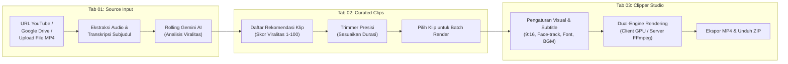
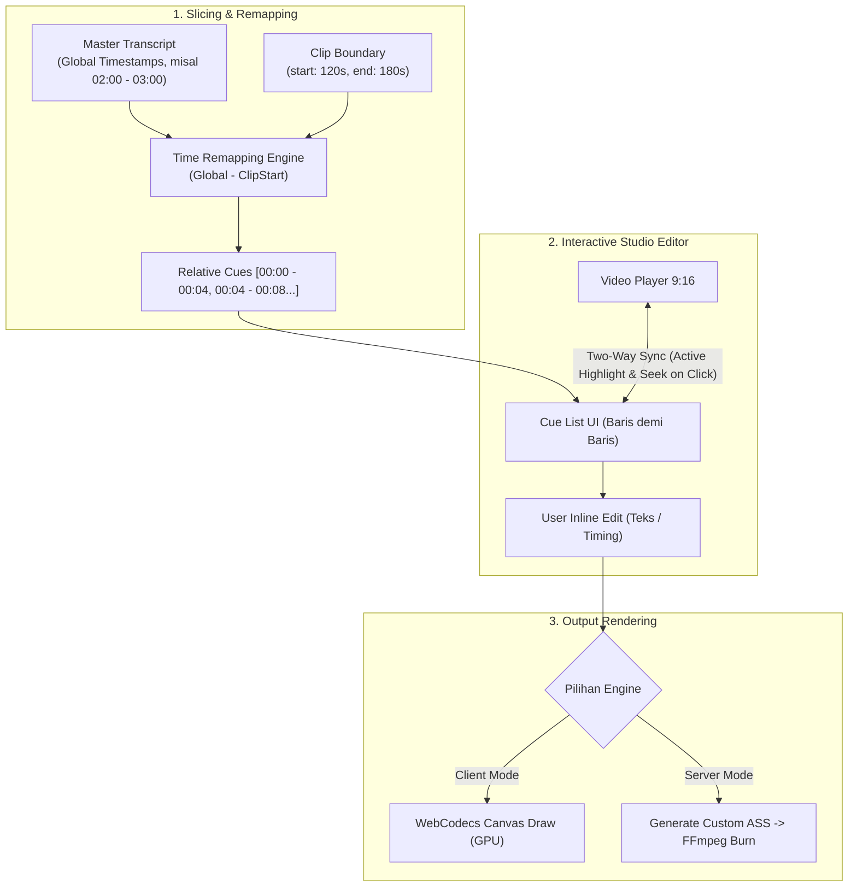
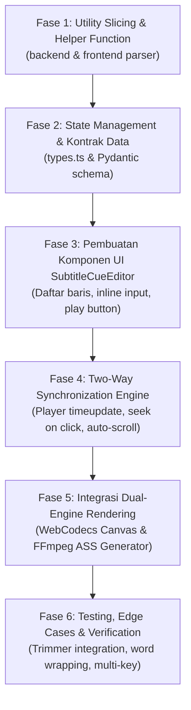

# 📑 Product Requirement Document (PRD) — Cheat Clip PRO

| Status | Versi | Terakhir Diperbarui | Target Platform | Penulis / Maintainer |
| :--- | :--- | :--- | :--- | :--- |
| **Active / Production Ready** | `v2.0.0` | Oktober 2026 | Web (React 19) & Desktop (.exe) | Cheat Clip PRO Engineering Team |

---

## 1. Executive Summary & Product Vision

### 1.1 Visi Produk
**Cheat Clip PRO** adalah platform pembuatan konten mikro (*micro-content generator*) bertenaga AI mutakhir yang mengotomatiskan seluruh alur kerja konversi video panjang (*long-form video*) menjadi klip vertikal pendek viral (*short-form video* 9:16 untuk TikTok, Instagram Reels, dan YouTube Shorts). 

Produk ini dirancang untuk memangkas waktu kerja editor dan kreator dari **3–5 jam kerja manual** menjadi **kurang dari 2 menit** melalui analisis prediktif viralitas berbasis retensi penonton (*audience retention heatmaps*) dan kecerdasan buatan Google Gemini.

### 1.2 Masalah yang Dipecahkan (*Problem Statement*)
1. **Pekerjaan Membosankan & Memakan Waktu**: Menonton ulang rekaman video/podcast berdurasi 1-3 jam untuk mencari kutipan atau momen menarik menghabiskan puluhan jam kerja setiap minggu.
2. **Keterbatasan Kuota AI Free-Tier (HTTP 429)**: Developer dan kreator sering terhambat kuota batas request per menit (RPM) Google Gemini API saat menganalisis transkrip panjang.
3. **Biaya Server Mahal (*Cloud Compute Bottleneck*)**: Rendering video di server cloud membutuhkan GPU mahal (AWS EC2 G4/G5) yang tidak terjangkau bagi kreator independen atau agency kecil.
4. **Subjudul Statis & Tidak Menarik**: Standar video pendek modern menuntut subjudul dinamis gaya karaoke (*word-by-word animated highlights*) dengan font viral, bukan subjudul SRT standar yang kaku.
5. **Wajah Terpotong saat Crop 9:16**: Cropping video 16:9 menjadi 9:16 secara statis di tengah sering kali membuat pembicara keluar dari bingkai frame.

### 1.3 Solusi (*Value Proposition*)
- **Multi-Key Rolling API (Maks. 10 API Key)**: Dukungan rotasi hingga 10 Gemini API key secara otomatis dengan load balancing berbasis RPM dan failover mulus saat terjadi limit kuota.
- **Client GPU WebCodecs Zero-Server-Cost**: Rendering instan langsung di GPU browser pengguna tanpa membebani server backend sepeser pun.
- **Smart OpenCV + YuNet Face Tracking**: Kamera digital otomatis mendeteksi dan melacak wajah pembicara sehingga selalu berada di tengah frame vertikal 9:16.
- **Animated Karaoke Subtitles**: Generator subjudul ASS bertenaga LibASS dengan highlight kata demi kata presisi tinggi.
- **Pre-Render Clip Trimmer**: Fleksibilitas memotong atau memperpanjang batas awal/akhir klip sebelum proses rendering final.

---

## 2. Target Persona & Use Cases

| Persona | Kebutuhan Utama | Bagaimana Cheat Clip PRO Membantu |
| :--- | :--- | :--- |
| **Podcaster & Talkshow Host** | Mengubah episode 1–2 jam menjadi 10-15 klip TikTok/Reels setiap minggu. | Input URL YouTube/Drive -> AI mendeteksi argumen/debat terpanas -> render vertikal dengan pelacakan wajah pembicara. |
| **Streamer / Gamer / VTuber** | Menemukan momen lucu, *clutch*, atau reaksi spontan saat live stream. | Heatmap retention YouTube mendeteksi lonjakan penonton -> klip dihasilkan dengan layout 1:1 atau 9:16. |
| **Social Media & Content Agency** | Menghasilkan ratusan konten untuk puluhan klien sekaligus secara efisien. | Batch render pipeline + custom watermark + custom BGM + preset nama file terotomasi. |
| **Edukator / Dosen / Motivator** | Menyaring poin-poin intisari pelajaran untuk diunggah ke Shorts. | Transkrip divalidasi ketat (Bahasa Indonesia & Inggris) -> klip berdiri sendiri (*standalone*) tanpa kehilangan konteks. |

---

## 3. Alur Kerja Pengguna (*User Workflow*)

Alur kerja aplikasi dirancang dalam **3 Tahap Utama (Pipeline 01 -> 02 -> 03)** yang terintegrasi secara modular:



---

## 4. Spesifikasi Fungsional Rinci

### 4.1 Tab 01: Ingestion & AI Analysis
- **Sumber Input Fleksibel**:
  - *YouTube URL*: Mendukung format link panjang, `youtu.be`, dan Shorts. Auto-fetch transkrip native YouTube atau fallback ke Whisper AI jika tanpa transkrip.
  - *Google Drive URL*: Otomatis mengonversi link sharing Drive menjadi direct download stream dengan visual progress bar.
  - *Upload Video Lokal*: Mendukung *drag-and-drop* file MP4/WebM/MKV hingga 2GB dengan pemutaran preview instan.
- **Gemini Rolling API Engine (Maksimal 10 Key)**:
  - Input single atau multi-key melalui UI terminal `KEY > •••••••••• [REVEAL]`.
  - Tombol modal **Gemini Rolling API Manager (Maks. 10 Key)** untuk paste key masal (per baris atau dipisahkan koma).
  - Slot status visual (`Slot 1...10: [READY] / [COOLING]`).
  - Algoritma rotasi *least-recently-used* (LRU) dan *lowest-requests-per-minute* (RPM) untuk meratakan distribusi beban.
  - Failover otomatis: Jika key saat ini mendapat respons HTTP 429 / 503, eksekusi otomatis berganti ke key berikutnya tanpa kegagalan proses.
- **Pilihan Preferensi Model AI**:
  - Google Gemini Official: `gemini-2.5-flash`, `gemini-1.5-flash`, `gemini-2.5-flash-lite`, `gemini-2.5-pro`.
  - OpenRouter Multi-LLM: Dukungan model alternatif open-source via OpenRouter API.
- **Pilihan Durasi Klip**:
  - `Auto`: Durasi dinamis alami antara 20 detik hingga 90 detik berbasis alur pembicaraan.
  - `15s`: Target 14-22 detik (ideal untuk hook singkat).
  - `30s`: Target 25-42 detik (standar Reels/TikTok).
  - `60s`: Target 48-75 detik (pembahasan topik mendalam).
- **Target Jumlah Klip**: Mode `Auto` (menyesuaikan durasi video) atau custom (1 s/d 25 klip).

### 4.2 Tab 02: Hasil Kurasi & Clip Trimmer
- **Visualisasi Kartu Klip Viral**:
  - Badge skor viralitas berjenjang neon (*Orange >90, Blue 75-89, Green <75*).
  - Rekomendasi Judul Viral (*Title Suggestion*) bebas kata ganti orang pertama (SOP pihak ketiga).
  - Rekomendasi *Caption* dan *Hashtag* siap salin dengan 1 klik.
  - Kutipan dialog langsung (*verbatim key quotes*).
- **Bilah Linimasa Heatmap Retention**:
  - Grafik visual interaktif yang menampilkan titik-titik puncak retensi penonton YouTube (*most replayed peaks*).
- **Modal Trimmer Presisi (*Pre-Render Context Adjuster*)**:
  - Pemutar video dengan scrubbing interaktif.
  - Tombol `-5s` / `+5s` untuk memperluas atau memangkas bagian awal (*start time*) maupun akhir (*end time*) klip.
  - Tombol *Apply* yang langsung menyinkronkan durasi baru ke state klip sebelum dirender.
  - Tombol *Download Raw Slice* untuk mengambil potongan video mentah tanpa burning subtitle.

### 4.3 Tab 03: Auto Clipper Studio & Kustomisasi
- **Aspek Rasio & Smart Crop**:
  - `9:16 Vertikal`: Format standar TikTok, Reels, Shorts.
  - `1:1 Square`: Format feed Instagram / LinkedIn.
  - `Original 16:9`: Format landscape.
- **Face Detection & Smart Tracking**:
  - Integrasi OpenCV Haar Cascade + YuNet ONNX Deep Learning.
  - Kamera digital otomatis menggeser koordinat X secara halus (*smooth lerp*) mengikuti pergerakan wajah pembicara agar tidak terpotong tepi layar.
- **Engine Subtitle Animasi Karaoke**:
  - Format output ASS (*Advanced SubStation Alpha*) dan SRT.
  - Pilihan preset font viral: *Anton, Bebas Neue, Montserrat, Poppins, Outfit, Inter*.
  - Efek highlight kata aktif (*word-by-word animated color pop*).
  - Konfigurasi huruf besar (*ALL CAPS toggle*), outline border tebal, drop shadow, dan posisi Y.
- **Editor Subtitle Kontekstual Berbasis Waktu Audio (*Time-Aligned Subtitle Cue Editor*)**:
  - Penyesuaian otomatis rentang transkrip terhadap potongan klip (*Time-Remapping*).
  - Tampilan baris demi baris terurut kronologis (*Cue List*) sesuai segmen audio asli.
  - Koreksi teks langsung (*in-line editing*) untuk membetulkan kesalahan dengar AI/Whisper.
  - Sinkronisasi dua arah (*two-way binding*) dengan pemutar video preview 9:16.
- **Background Music (BGM)**:
  - Kemampuan mengunggah musik latar dengan pengaturan volume otomatis (*ducking* di bawah suara vokal pembicara).
- **Watermark & Branding**:
  - Unggah logo/watermark PNG transparan dengan posisi sudut yang dapat diatur (*top-left, top-right, bottom-left, bottom-right*).
- **Custom Filename Template**:
  - Pengaturan pola nama file ekspor otomatis menggunakan variabel `{title}`, `{score}`, `{index}`, `{duration}`.

### 4.4 Engine Rendering Ganda (*Dual Rendering Engine*)
| Fitur | Client GPU WebCodecs Engine | Server FFmpeg Engine |
| :--- | :--- | :--- |
| **Tempat Eksekusi** | Browser Pengguna (Zero Server Cost) | Server Lokal / Cloud (FastAPI) |
| **Akselerasi** | Hardware GPU Browser (WebCodecs API) | Hardware Accel FFmpeg (NVENC, QSV, AMF, CPU libx264) |
| **Format Output** | MP4 via `mp4-muxer` | MP4 H.264 / AAC via FFmpeg |
| **Face Tracking** | Client Canvas Face Detection | OpenCV Haar Cascade + YuNet ONNX |
| **Subtitle Engine** | Canvas Dynamic Subtitle Rendering | LibASS Native Subtitle Burning |
| **Kecepatan** | Ekstrem (2x-5x realtime pada GPU modern) | Bergantung spesifikasi CPU/GPU server |

---

## 5. Kebutuhan Non-Fungsional (*Non-Functional Requirements*)

### 5.1 Keamanan & Privasi
- **Centralized Log Redaction**: Seluruh logger backend menyaring string API key dan kredensial sensitif sehingga tidak pernah tercatat di log file atau konsol terminal.
- **Header-Based Auth Migration**: API Key Gemini dan OpenRouter dikirim via HTTP Headers (`X-Gemini-API-Key`, `X-OpenRouter-API-Key`) untuk mencegah kebocoran token di URL parameters atau reverse-proxy access logs.
- **Sanitized Error Responses**: FastAPI menangkap error unhandled dan menyamarkan error message sebelum dikembalikan ke client untuk mencegah eksposur informasi internal (*information disclosure*).
- **Stateless Cookies**: File cookie pengguna disimpan di browser `localStorage` dan hanya diproses secara ephemeral tanpa retensi permanen di server publik.

### 5.2 Performa & Skalabilitas
- **Real-Time Progress Streaming**: Seluruh proses analisis dan rendering dilaporkan detik-demi-detik melalui Server-Sent Events (SSE) dengan indikator persentase, estimasi waktu, dan tahap inferensi.
- **Auto-Cleanup Storage Daemon**: Background worker berjalan setiap 30 menit membersihkan file unduhan sementara yang berusia lebih dari 1 jam dengan kuota maksimal 5GB.
- **Memory Management**: Whisper AI model secara otomatis dilepaskan dari RAM (*garbage collection*) setelah ekstraksi selesai untuk mencegah *out-of-memory* pada server spek terbatas.

### 5.3 Desain Antarmuka & UX
- **Brutalist Cyber Aesthetics (Blue Neon Theme)**:
  - Palet warna gelap arang (*dark charcoal* `#060608`) berpadu dengan aksen neon biru elektrik (`#00f0ff` & `#38bdf8`).
  - Tipografi monospaced presisi (*JetBrains Mono*) pada elemen teknis dan kontrol terminal.
  - Responsif pada layar desktop lebar maupun perangkat mobile dengan wake-lock aktif saat rendering berlangsung.

### 5.4 Distribusi Multi-Platform
1. **Web Version**: Dijalankan secara modular via `npm run dev` (Vite port 5173 + FastAPI port 8000).
2. **Standalone Desktop Application**:
   - Dibundel menggunakan PyInstaller (`cheat-clip-backend.exe`) dan Electron.
   - Installer setup wizard profesional untuk Windows (`win-unpacked` dan NSIS Setup `.exe`).
   - Penanganan unduhan native Electron yang otomatis menyimpan berkas ke folder `Downloads` Windows.

---

## 6. Metrik Keberhasilan Produk (*KPIs*)

1. **Akurasi Deteksi Klip**: Minimal **85%** klip yang direkomendasikan AI memiliki awal dan akhir kalimat yang utuh tanpa terpotong di tengah kata (*boundary snapping*).
2. **Ketersediaan Layanan Tanpa Limit Kuota**: Multi-key rolling API menekan tingkat kegagalan akibat error HTTP 429 hingga **di bawah 1%** saat menggunakan minimal 3 Gemini keys.
3. **Efisiensi Waktu Rendering**: Mode Client GPU WebCodecs mampu merender klip 60 detik dalam waktu kurang dari **20 detik** pada GPU standar laptop.
4. **Zero Configuration**: Pengguna dapat menjalankan versi desktop installer tanpa perlu menginstal Python, Node.js, atau dependensi eksternal secara manual.

---

## 7. Spesifikasi Detail & Rencana Eksekusi: Editor Subtitle Kontekstual Berbasis Waktu Audio

Bagian ini mendefinisikan secara spesifik arsitektur teknis, kontrak data, interaksi antarmuka pengguna, dan tahapan eksekusi langkah demi langkah untuk fitur **Editor Subtitle Kontekstual Berbasis Waktu Audio (*Time-Aligned Subtitle Cue Editor*)**.



### 7.1 Latar Belakang & Kebutuhan Pengguna
Saat video berdurasi panjang dipotong menjadi klip 30–60 detik, model AI (Whisper atau YouTube Caption API) sering menghasilkan teks transkrip dengan sedikit ketidaksempurnaan:
1. **Kesalahan Ejaan / Slang**: AI sering salah mengeja nama entitas, istilah teknis, atau kata gaul bahasa Indonesia (*"kocak"*, *"gue"*, *"lu"*, *"mantul"*).
2. **Kerapian Layar Vertikal (9:16)**: Kalimat yang terlalu panjang perlu dipenggal agar pas dengan ruang sempit layar vertikal tanpa menutupi visual penting.
3. **Ketiadaan Konteks Waktu pada Editor Standar**: Pada sebagian besar software, subtitle disajikan sebagai teks mentah global tanpa pemisahan per durasi klip hasil potongan, menyulitkan editor melacak kalimat mana yang sedang diucapkan pada detik tertentu.

---

### 7.2 Logika Matematika & Pemotongan Waktu (*Time-Remapping Algorithm*)

Jika klip hasil kurasi memiliki batas waktu pada video master:
- $T_{\text{start}} = 120.0 \text{ detik}$ (Menit `02:00`)
- $T_{\text{end}} = 180.0 \text{ detik}$ (Menit `03:00`)

Maka setiap segmen transkrip master $S_i$ dengan rentang global $[t_{\text{start}, i}, t_{\text{end}, i}]$ diproses dengan aturan:

1. **Filter Irisan (*Intersection Filter*)**:
   Segmen hanya disertakan jika memiliki irisan dengan durasi klip:
   $$t_{\text{end}, i} > T_{\text{start}} \quad \text{DAN} \quad t_{\text{start}, i} < T_{\text{end}}$$

2. **Pergeseran Waktu Relatif (*Relative Offset Calculation*)**:
   Waktu segmen diubah menjadi format 0-based relatif terhadap awal klip:
   $$t_{\text{rel\_start}, i} = \max(0.0, \, t_{\text{start}, i} - T_{\text{start}})$$
   $$t_{\text{rel\_end}, i} = \min(T_{\text{end}} - T_{\text{start}}, \, t_{\text{end}, i} - T_{\text{start}})$$

3. **Format Tampilan Timecode**:
   Setiap baris cue diformat menjadi format MM:SS atau SS.d:
   Contoh: Global `02:00.0 - 02:04.2` $\rightarrow$ Relatif `00:00.0 - 00:04.2`.

---

### 7.3 Struktur Data Model (TypeScript & Pydantic)

#### TypeScript Interface (`src/types.ts`):
```typescript
export interface SubtitleCue {
  id: string;               // Unique ID (misal: "cue-1", "cue-2")
  originalStart: number;    // Detik asli pada video master (misal 120.0)
  originalEnd: number;      // Detik akhir asli pada video master (misal 124.2)
  start: number;            // Detik mulai relatif terhadap klip (0.0)
  end: number;              // Detik selesai relatif terhadap klip (4.2)
  text: string;             // Teks kalimat yang dapat diedit langsung
  isEdited?: boolean;       // Menandai jika kalimat sudah diubah pengguna
}
```

#### Pydantic Schema Backend (`backend/schemas/render.py`):
```python
class SubtitleCueItem(BaseModel):
    id: str
    start: float
    end: float
    text: str

class ServerRenderRequest(BaseModel):
    video_id: str
    clip_id: str
    start_time: float
    end_time: float
    aspect_ratio: str = "9:16"
    font_family: str = "Anton"
    custom_cues: Optional[List[SubtitleCueItem]] = None  # Cues hasil editan pengguna
```

---

### 7.4 Spesifikasi UI/UX Komponen (`SubtitleCueEditor.tsx`)

Komponen diletakkan di **Tab 03 (Clip Studio)** di bawah panel pratinjau video atau di bilah kontrol samping:

1. **Header Panel Editor**:
   - Judul: `[ CUE LIST EDITOR ]` dengan indikator jumlah baris (contoh: `14 Baris Subtitle`).
   - Tombol Aksi: `[ Reset ke Transkrip AI ]` dan `[ + Tambah Baris ]`.
2. **Kartu Baris Subtitle (Cue Card)**:
   - **Timecode Badge**: Label neon `[00:00 - 00:04]` yang menunjukkan kapan kalimat muncul dan berakhir.
   - **Interactive Text Input**: Textarea / input dengan font monospace yang langsung merespons ketikan pengguna.
   - **Play Segment Button (▶)**: Menekan tombol ini akan memerintahkan pemutar video untuk langsung melakukan *seek* ke detik mulai kalimat tersebut dan memutarnya selama rentang cue.
   - **Split Cue Button (✂)**: Membelah 1 baris panjang menjadi 2 baris terpisah dengan durasi dibagi dua secara proporsional.
   - **Delete Button (🗑)**: Menghapus baris cue tertentu jika audio hanya berisi desahan/noise yang tidak memerlukan teks.
3. **Sinkronisasi Dua Arah (*Two-Way Reactive Synchronization*)**:
   - **Active State Highlighting**: Saat video diputar, listener `timeupdate` pada player mendeteksi apakah `video.currentTime` berada di dalam rentang `cue.start` dan `cue.end`. Baris yang aktif otomatis mendapat border glow Blue Neon (`#00f0ff`) dan scroll otomatis agar selalu terlihat.
   - **Real-Time Canvas Update**: Setiap karakter yang diketikkan di input box langsung mengubah teks yang dirender di canvas 9:16 tanpa jeda *re-render*.

---

### 7.5 Integrasi Rendering Ganda (*Dual Rendering Pipeline*)

1. **Jalur Client-Side GPU (WebCodecs)**:
   - State `cues` yang sudah diedit diteruskan ke `webcodecsRenderer.ts`.
   - Engine per-frame canvas langsung mengambil array `cues` terbaru untuk menggambar teks subtitle di atas frame video dengan font dan warna yang dipilih.
2. **Jalur Server-Side (FFmpeg & LibASS)**:
   - Jika pengguna memilih render server, array `custom_cues` dikirimkan ke endpoint `/api/render/server`.
   - Backend memotong proses pembacaan file `.ass` mentah, dan memanggil fungsi `generate_ass_from_cues(custom_cues, style_config)` untuk menciptakan file subtitle `.ass` baru yang identik dengan editan pengguna sebelum dibakar via filter FFmpeg `subtitles=temp.ass`.

---

### 7.6 Rencana Eksekusi Langkah Demi Langkah (*Step-by-Step Execution Plan*)

Rencana eksekusi dibagi menjadi 6 tahap terstruktur untuk memastikan stabilitas dan zero-regression:



#### Fase 1: Utility Slicing & Helper Function
- Membuat fungsi utilitas murni `sliceTranscriptForClip(fullTranscript, startTime, endTime)` di `src/utils/subtitleUtils.ts`.
- Fungsi menerima transkrip lengkap dan rentang klip, lalu mengembalikan array `SubtitleCue[]` dengan waktu yang sudah di-*re-map* menjadi 0-based.
- Menyediakan fallback cerdas: Jika transkrip asli tidak memiliki timestamp per kata, buat pemotongan berbasis estimasi laju kata per detik (*words per second rate estimation* ~ 2.5 kata/detik).

#### Fase 2: State Management & Kontrak Data
- Menambahkan interface `SubtitleCue` ke dalam `src/types.ts`.
- Menambahkan state `clipCues: SubtitleCue[]` dan `activeCueId: string | null` pada `ClipStudioSection.tsx` atau `App.tsx`.
- Menyinkronkan perubahan saat pengguna berganti klip pilihan di Tab 02.

#### Fase 3: Komponen UI `SubtitleCueEditor.tsx`
- Membangun komponen mandiri dengan styling Blue Neon Cyberpunk (menggunakan CSS variables `--primary: #00f0ff`, `--bg-surface: #0a0a0f`, `--border-color: #201e2c`).
- Menyediakan baris cue card fleksibel dengan input teks, timecode pill, tombol play preview segmen, tombol split, dan tombol hapus.

#### Fase 4: Two-Way Synchronization Engine
- Menghubungkan video element `ref` ke `SubtitleCueEditor`:
  - Saat baris cue diklik, jalankan `videoRef.currentTime = cue.start`.
  - Pasang event handler `onTimeUpdate` pada pemutar video untuk memperbarui `activeCueId`.
  - Pasang efek visual scroll otomatis (*scrollIntoView with smooth behavior*) agar baris yang sedang aktif selalu berada di tengah viewport daftar editor.

#### Fase 5: Integrasi Dual Rendering Engine
- **Client WebCodecs**: Mengirimkan array `clipCues` ke `src/services/webcodecsRenderer.ts` sehingga canvas per-frame drawing menggunakan teks terkini hasil modifikasi.
- **Server FFmpeg**: Memperbarui payload `/api/render/server` dengan parameter `custom_cues`. Di backend `backend/services/render_service.py`, buat generator file `.ass` dinamis yang menyusun dialog event dari `custom_cues`.

#### Fase 6: Pengujian Kasus Ekstrem (*Edge Cases*) & Verifikasi
- Menguji skenario ketika klip dipangkas ulang melalui **Trimmer Modal**: Cues otomatis dihitung ulang menyesuaikan boundary baru tanpa menghilangkan teks yang sudah diedit.
- Menguji teks panjang dengan pengetikan tanda baca khusus, kutip ganda, atau emoji.
- Verifikasi hasil akhir ekspor MP4 pada kedua engine (Client GPU dan Server FFmpeg) untuk memastikan teks yang terbakar di video 100% identik dengan apa yang diketikkan pengguna di editor.


