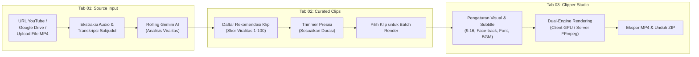

# 📑 Product Requirement Document (PRD) — Cheat Clip PRO

| Status | Versi | Terakhir Diperbarui | Target Platform | Penulis / Maintainer |
| :--- | :--- | :--- | :--- | :--- |
| **Active / Production Ready** | `v2.0.0` | Oktober 2026 | Web (React 19) & Desktop (.exe) | Cheat Clip PRO Engineering Team |

---

## 1. Executive Summary & Product Vision

### 1.1 Visi Produk
**Cheat Clip PRO** adalah platform pembuatan konten mikro (*micro-content generator*) bertenaga AI mutakhir yang mengotomatiskan seluruh alur kerja konversi video panjang (*long-form video*) menjadi klip vertikal pendek viral (*short-form video* 9:16 untuk TikTok, Instagram Reels, dan YouTube Shorts). 

Produk ini dirancang untuk memangkas waktu kerja editor dan kreator dari **3–5 jam kerja manual** menjadi **kurang dari 2 menit** melalui analisis prediktif viralitas berbasis retensi penonton (*audience retention heatmaps*) dan kecerdasan buatan Google Gemini.

### 1.2 Masalah yang Dipecahkan (*Problem Statement*)
1. **Pekerjaan Membosankan & Memakan Waktu**: Menonton ulang rekaman video/podcast berdurasi 1-3 jam untuk mencari kutipan atau momen menarik menghabiskan puluhan jam kerja setiap minggu.
2. **Keterbatasan Kuota AI Free-Tier (HTTP 429)**: Developer dan kreator sering terhambat kuota batas request per menit (RPM) Google Gemini API saat menganalisis transkrip panjang.
3. **Biaya Server Mahal (*Cloud Compute Bottleneck*)**: Rendering video di server cloud membutuhkan GPU mahal (AWS EC2 G4/G5) yang tidak terjangkau bagi kreator independen atau agency kecil.
4. **Subjudul Statis & Tidak Menarik**: Standar video pendek modern menuntut subjudul dinamis gaya karaoke (*word-by-word animated highlights*) dengan font viral, bukan subjudul SRT standar yang kaku.
5. **Wajah Terpotong saat Crop 9:16**: Cropping video 16:9 menjadi 9:16 secara statis di tengah sering kali membuat pembicara keluar dari bingkai frame.

### 1.3 Solusi (*Value Proposition*)
- **Multi-Key Rolling API (Maks. 10 API Key)**: Dukungan rotasi hingga 10 Gemini API key secara otomatis dengan load balancing berbasis RPM dan failover mulus saat terjadi limit kuota.
- **Client GPU WebCodecs Zero-Server-Cost**: Rendering instan langsung di GPU browser pengguna tanpa membebani server backend sepeser pun.
- **Smart OpenCV + YuNet Face Tracking**: Kamera digital otomatis mendeteksi dan melacak wajah pembicara sehingga selalu berada di tengah frame vertikal 9:16.
- **Animated Karaoke Subtitles**: Generator subjudul ASS bertenaga LibASS dengan highlight kata demi kata presisi tinggi.
- **Pre-Render Clip Trimmer**: Fleksibilitas memotong atau memperpanjang batas awal/akhir klip sebelum proses rendering final.

---

## 2. Target Persona & Use Cases

| Persona | Kebutuhan Utama | Bagaimana Cheat Clip PRO Membantu |
| :--- | :--- | :--- |
| **Podcaster & Talkshow Host** | Mengubah episode 1–2 jam menjadi 10-15 klip TikTok/Reels setiap minggu. | Input URL YouTube/Drive -> AI mendeteksi argumen/debat terpanas -> render vertikal dengan pelacakan wajah pembicara. |
| **Streamer / Gamer / VTuber** | Menemukan momen lucu, *clutch*, atau reaksi spontan saat live stream. | Heatmap retention YouTube mendeteksi lonjakan penonton -> klip dihasilkan dengan layout 1:1 atau 9:16. |
| **Social Media & Content Agency** | Menghasilkan ratusan konten untuk puluhan klien sekaligus secara efisien. | Batch render pipeline + custom watermark + custom BGM + preset nama file terotomasi. |
| **Edukator / Dosen / Motivator** | Menyaring poin-poin intisari pelajaran untuk diunggah ke Shorts. | Transkrip divalidasi ketat (Bahasa Indonesia & Inggris) -> klip berdiri sendiri (*standalone*) tanpa kehilangan konteks. |

---

## 3. Alur Kerja Pengguna (*User Workflow*)

Alur kerja aplikasi dirancang dalam **3 Tahap Utama (Pipeline 01 -> 02 -> 03)** yang terintegrasi secara modular:

---

## 4. Spesifikasi Fungsional Rinci

### 4.1 Tab 01: Ingestion & AI Analysis
- **Sumber Input Fleksibel**:
  - *YouTube URL*: Mendukung format link panjang, `youtu.be`, dan Shorts. Auto-fetch transkrip native YouTube atau fallback ke Whisper AI jika tanpa transkrip.
  - *Google Drive URL*: Otomatis mengonversi link sharing Drive menjadi direct download stream dengan visual progress bar.
  - *Upload Video Lokal*: Mendukung *drag-and-drop* file MP4/WebM/MKV hingga 2GB dengan pemutaran preview instan.
- **Gemini Rolling API Engine (Maksimal 10 Key)**:
  - Input single atau multi-key melalui UI terminal `KEY > •••••••••• [REVEAL]`.
  - Tombol modal **Gemini Rolling API Manager (Maks. 10 Key)** untuk paste key masal (per baris atau dipisahkan koma).
  - Slot status visual (`Slot 1...10: [READY] / [COOLING]`).
  - Algoritma rotasi *least-recently-used* (LRU) dan *lowest-requests-per-minute* (RPM) untuk meratakan distribusi beban.
  - Failover otomatis: Jika key saat ini mendapat respons HTTP 429 / 503, eksekusi otomatis berganti ke key berikutnya tanpa kegagalan proses.
- **Pilihan Preferensi Model AI**:
  - Google Gemini Official: `gemini-2.5-flash`, `gemini-1.5-flash`, `gemini-2.5-flash-lite`, `gemini-2.5-pro`.
  - OpenRouter Multi-LLM: Dukungan model alternatif open-source via OpenRouter API.
- **Pilihan Durasi Klip**:
  - `Auto`: Durasi dinamis alami antara 20 detik hingga 90 detik berbasis alur pembicaraan.
  - `15s`: Target 14-22 detik (ideal untuk hook singkat).
  - `30s`: Target 25-42 detik (standar Reels/TikTok).
  - `60s`: Target 48-75 detik (pembahasan topik mendalam).
- **Target Jumlah Klip**: Mode `Auto` (menyesuaikan durasi video) atau custom (1 s/d 25 klip).

### 4.2 Tab 02: Hasil Kurasi & Clip Trimmer
- **Visualisasi Kartu Klip Viral**:
  - Badge skor viralitas berjenjang neon (*Orange >90, Blue 75-89, Green <75*).
  - Rekomendasi Judul Viral (*Title Suggestion*) bebas kata ganti orang pertama (SOP pihak ketiga).
  - Rekomendasi *Caption* dan *Hashtag* siap salin dengan 1 klik.
  - Kutipan dialog langsung (*verbatim key quotes*).
- **Bilah Linimasa Heatmap Retention**:
  - Grafik visual interaktif yang menampilkan titik-titik puncak retensi penonton YouTube (*most replayed peaks*).
- **Modal Trimmer Presisi (*Pre-Render Context Adjuster*)**:
  - Pemutar video dengan scrubbing interaktif.
  - Tombol `-5s` / `+5s` untuk memperluas atau memangkas bagian awal (*start time*) maupun akhir (*end time*) klip.
  - Tombol *Apply* yang langsung menyinkronkan durasi baru ke state klip sebelum dirender.
  - Tombol *Download Raw Slice* untuk mengambil potongan video mentah tanpa burning subtitle.

### 4.3 Tab 03: Auto Clipper Studio & Kustomisasi
- **Aspek Rasio & Smart Crop**:
  - `9:16 Vertikal`: Format standar TikTok, Reels, Shorts.
  - `1:1 Square`: Format feed Instagram / LinkedIn.
  - `Original 16:9`: Format landscape.
- **Face Detection & Smart Tracking**:
  - Integrasi OpenCV Haar Cascade + YuNet ONNX Deep Learning.
  - Kamera digital otomatis menggeser koordinat X secara halus (*smooth lerp*) mengikuti pergerakan wajah pembicara agar tidak terpotong tepi layar.
- **Engine Subtitle Animasi Karaoke**:
  - Format output ASS (*Advanced SubStation Alpha*) dan SRT.
  - Pilihan preset font viral: *Anton, Bebas Neue, Montserrat, Poppins, Outfit, Inter*.
  - Efek highlight kata aktif (*word-by-word animated color pop*).
  - Konfigurasi huruf besar (*ALL CAPS toggle*), outline border tebal, drop shadow, dan posisi Y.
- **Background Music (BGM)**:
  - Kemampuan mengunggah musik latar dengan pengaturan volume otomatis (*ducking* di bawah suara vokal pembicara).
- **Watermark & Branding**:
  - Unggah logo/watermark PNG transparan dengan posisi sudut yang dapat diatur (*top-left, top-right, bottom-left, bottom-right*).
- **Custom Filename Template**:
  - Pengaturan pola nama file ekspor otomatis menggunakan variabel `{title}`, `{score}`, `{index}`, `{duration}`.

### 4.4 Engine Rendering Ganda (*Dual Rendering Engine*)
| Fitur | Client GPU WebCodecs Engine | Server FFmpeg Engine |
| :--- | :--- | :--- |
| **Tempat Eksekusi** | Browser Pengguna (Zero Server Cost) | Server Lokal / Cloud (FastAPI) |
| **Akselerasi** | Hardware GPU Browser (WebCodecs API) | Hardware Accel FFmpeg (NVENC, QSV, AMF, CPU libx264) |
| **Format Output** | MP4 via `mp4-muxer` | MP4 H.264 / AAC via FFmpeg |
| **Face Tracking** | Client Canvas Face Detection | OpenCV Haar Cascade + YuNet ONNX |
| **Subtitle Engine** | Canvas Dynamic Subtitle Rendering | LibASS Native Subtitle Burning |
| **Kecepatan** | Ekstrem (2x-5x realtime pada GPU modern) | Bergantung spesifikasi CPU/GPU server |

---

## 5. Kebutuhan Non-Fungsional (*Non-Functional Requirements*)

### 5.1 Keamanan & Privasi
- **Centralized Log Redaction**: Seluruh logger backend menyaring string API key dan kredensial sensitif sehingga tidak pernah tercatat di log file atau konsol terminal.
- **Header-Based Auth Migration**: API Key Gemini dan OpenRouter dikirim via HTTP Headers (`X-Gemini-API-Key`, `X-OpenRouter-API-Key`) untuk mencegah kebocoran token di URL parameters atau reverse-proxy access logs.
- **Sanitized Error Responses**: FastAPI menangkap error unhandled dan menyamarkan error message sebelum dikembalikan ke client untuk mencegah eksposur informasi internal (*information disclosure*).
- **Stateless Cookies**: File cookie pengguna disimpan di browser `localStorage` dan hanya diproses secara ephemeral tanpa retensi permanen di server publik.

### 5.2 Performa & Skalabilitas
- **Real-Time Progress Streaming**: Seluruh proses analisis dan rendering dilaporkan detik-demi-detik melalui Server-Sent Events (SSE) dengan indikator persentase, estimasi waktu, dan tahap inferensi.
- **Auto-Cleanup Storage Daemon**: Background worker berjalan setiap 30 menit membersihkan file unduhan sementara yang berusia lebih dari 1 jam dengan kuota maksimal 5GB.
- **Memory Management**: Whisper AI model secara otomatis dilepaskan dari RAM (*garbage collection*) setelah ekstraksi selesai untuk mencegah *out-of-memory* pada server spek terbatas.

### 5.3 Desain Antarmuka & UX
- **Brutalist Cyber Aesthetics (Blue Neon Theme)**:
  - Palet warna gelap arang (*dark charcoal* `#060608`) berpadu dengan aksen neon biru elektrik (`#00f0ff` & `#38bdf8`).
  - Tipografi monospaced presisi (*JetBrains Mono*) pada elemen teknis dan kontrol terminal.
  - Responsif pada layar desktop lebar maupun perangkat mobile dengan wake-lock aktif saat rendering berlangsung.

### 5.4 Distribusi Multi-Platform
1. **Web Version**: Dijalankan secara modular via `npm run dev` (Vite port 5173 + FastAPI port 8000).
2. **Standalone Desktop Application**:
   - Dibundel menggunakan PyInstaller (`cheat-clip-backend.exe`) dan Electron.
   - Installer setup wizard profesional untuk Windows (`win-unpacked` dan NSIS Setup `.exe`).
   - Penanganan unduhan native Electron yang otomatis menyimpan berkas ke folder `Downloads` Windows.

---

## 6. Metrik Keberhasilan Produk (*KPIs*)

1. **Akurasi Deteksi Klip**: Minimal **85%** klip yang direkomendasikan AI memiliki awal dan akhir kalimat yang utuh tanpa terpotong di tengah kata (*boundary snapping*).
2. **Ketersediaan Layanan Tanpa Limit Kuota**: Multi-key rolling API menekan tingkat kegagalan akibat error HTTP 429 hingga **di bawah 1%** saat menggunakan minimal 3 Gemini keys.
3. **Efisiensi Waktu Rendering**: Mode Client GPU WebCodecs mampu merender klip 60 detik dalam waktu kurang dari **20 detik** pada GPU standar laptop.
4. **Zero Configuration**: Pengguna dapat menjalankan versi desktop installer tanpa perlu menginstal Python, Node.js, atau dependensi eksternal secara manual.

