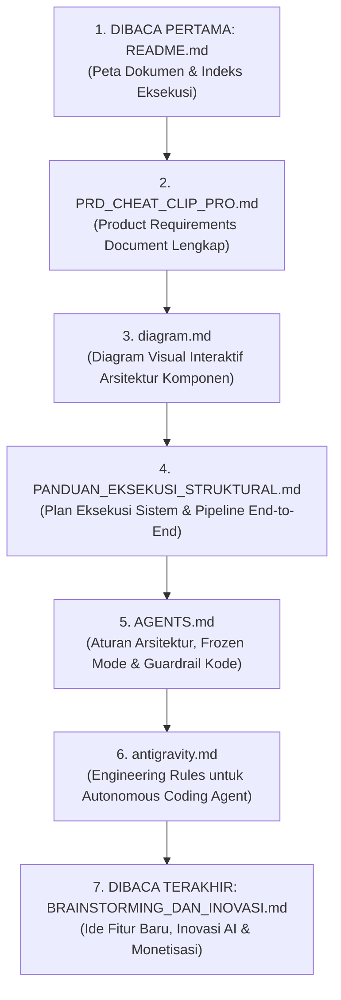

# 📚 Dokumentasi Resmi Cheat Clip PRO

Selamat datang di portal dokumentasi resmi dan arsitektur teknis **Cheat Clip PRO**. Dokumentasi ini disusun secara terstruktur dengan urutan pembacaan terpandu (*Reading Roadmap*) dari level konseptual bisnis/produk hingga level implementasi teknis dan inovasi masa depan.

---

## 🗺️ Urutan Pembacaan Wajib (Reading Roadmap)

Agar mendapatkan pemahaman menyeluruh tanpa kehilangan konteks, ikuti urutan pembacaan berikut dari yang **paling awal (wajib dibaca pertama)** hingga yang **paling akhir (eksplorasi & masa depan)**:

---

## 📂 Daftar & Deskripsi Dokumen

| No | File Dokumen | Deskripsi & Tujuan | Prioritas Baca |
| :---: | :--- | :--- | :---: |
| **01** | [`README.md`](./README.md) *(Dokumen Ini)* | **Pintu Gerbang & Peta Navigasi.** Berisi panduan urutan baca terstruktur, matriks dokumen, dan ikhtisar eksekutif proyek. | **Wajib Pertama** |
| **02** | [`PRD_CHEAT_CLIP_PRO.md`](./PRD_CHEAT_CLIP_PRO.md) | **Product Requirements Document (PRD).** Definisi produk menyeluruh: visi, latar belakang masalah, persona pengguna, spesifikasi fungsional (Tab 01 - Tab 03), metrik keberhasilan, dan batas ruang lingkup (*scope*). | **Kedua** |
| **03** | [`diagram.md`](./diagram.md) | **Diagram Arsitektur Komponen Visual.** Peta visual relasi dan alur data antara Client (React), API Router (FastAPI), Analysis Services, Media Pipeline, dan External Services. | **Ketiga** |
| **04** | [`PANDUAN_EKSEKUSI_STRUKTURAL.md`](./PANDUAN_EKSEKUSI_STRUKTURAL.md) | **Plan Eksekusi Teknis & Workflow Pipeline.** Alur operasional modular end-to-end: input ingestion, transkripsi Whisper/YouTube, Gemini Rolling API (10 keys), Trimmer, hingga Rendering Dual-Engine (Client GPU WebCodecs vs Server FFmpeg). | **Keempat** |
| **05** | [`AGENTS.md`](./AGENTS.md) | **SOP Developer & Sistem AI.** Aturan esensial PyInstaller standalone mode (`sys.frozen`), yt-dlp CLI interceptor, resolusi path aset/font, keamanan token, dan styling Vanilla CSS. | **Kelima** |
| **06** | [`antigravity.md`](./antigravity.md) | **Autonomous Agent Engineering Guardrails.** Panduan disiplin modifikasi kode, diff minimalis, closed-loop terminal verification, dan pencegahan loop agent di Google Antigravity IDE. | **Keenam** |
| **07** | [`BRAINSTORMING_DAN_INOVASI.md`](./BRAINSTORMING_DAN_INOVASI.md) | **Inovasi, Riset & Ideasi Masa Depan.** Rencana pengembangan model Vision multimodal Gemini 3.8, auto-caption animasi ala Hormozi/Beast, integrasi auto-post medsos API, arsitektur distributed rendering, dan model bisnis SaaS. | **Paling Terakhir** |

---

## 💡 Ringkasan Inti Cheat Clip PRO

Cheat Clip PRO adalah platform otomasi video clipping bertenaga AI yang dirancang untuk mengubah video format panjang (*long-form video* dari YouTube, Google Drive, atau Upload Lokal) menjadi konten vertikal pendek (*short-form video* 9:16 untuk TikTok, Instagram Reels, dan YouTube Shorts).

### Pilar Keunggulan Utama:
1. **Multi-Key Rolling API (Maks. 10 API Key)**: Mengeliminasi limitasi kuota free-tier Google Gemini dengan rotasi dinamis otomatis dan load balancing berbasis RPM.
2. **Dual Rendering Engine**:
   - **Client-Side GPU WebCodecs**: Zero-server-cost video clipping langsung menggunakan akselerasi GPU browser pengguna.
   - **Server-Side FFmpeg Engine**: Rendering presisi tinggi dengan *face-tracking* (OpenCV Haar + YuNet ONNX) dan burning subtitle ASS karaoke.
3. **Smart Retention & Viral Hook Detection**: Integrasi YouTube audience engagement heatmap + Gemini Flash AI untuk memilah hanya momen paling berpotensi viral.
4. **Distribusi Fleksibel**: Dapat dijalankan sebagai Web App modern (React 19 + FastAPI) maupun Desktop App mandiri offline (.exe via Electron + PyInstaller).

---

## 👥 Tim & Kontributor

- **[Bayunity-Brkhstd](https://github.com/Bayunity-Brkhstd)** — Project Creator & Lead Maintainer
- **[Antigravity](https://deepmind.google/)** — AI Autonomous Engineering & Coding Partner (Google DeepMind)
