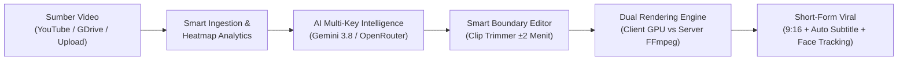

# 🌐 Konteks Proyek & Domain Knowledge — Cheat Clip PRO

Dokumen ini mendokumentasikan konteks fundamental, lanskap domain industri, latar belakang masalah, batasan ekosistem, serta kamus istilah (*glossary*) yang mendasari perancangan dan operasional **Cheat Clip PRO**.

---

## 📌 1. Latar Belakang & Lanskap Masalah

### A. Ledakan Konten Vertikal (*Short-Form Video Boom*)
Dalam era konsumsi digital modern (TikTok, Instagram Reels, YouTube Shorts), audiens bergeser secara masif ke konten video pendek berdurasi 15–60 detik dengan rasio aspek vertikal 9:16. Namun, sebagian besar kreator, podcaster, dan agensi media memproduksi konten master dalam format horizontal panjang (*long-form video* 16:9) seperti podcast 1–3 jam, webinar, rekaman streaming, dan video edukasi.

### B. Bottleneck Produksi Manual
Mengubah video 16:9 panjang menjadi klip pendek 9:16 secara manual membutuhkan waktu 2 hingga 4 jam per episode:
1. **Penyisiran Manual**: Editor harus menonton keseluruhan video untuk mencari bagian percakapan atau hook yang menarik.
2. **Subtitling Membosankan**: Transkripsi manual kata-demi-kata dan pengaturan timing subtitle membutuhkan ketelitian tinggi.
3. **Perekaman Ulang / Cropping Manual**: Memposisikan wajah pembicara ke tengah frame (pan & scan) secara frame-by-frame menghabiskan waktu.
4. **Keterbatasan Biaya Server**: Solusi cloud SaaS clipping yang ada di pasar (seperti OpusClip atau Klap) mengenakan biaya kredit bulanan yang mahal dan rendering di antrean server yang lambat.

---

## 🎯 2. Visi & Nilai Strategis Cheat Clip PRO

Cheat Clip PRO hadir sebagai **platform otomasi video clipping AI hibrida (Web & Desktop Standalone)** yang memotong waktu produksi dari jam menjadi menit dengan prinsip:

### Nilai Utama:
- **Zero Server Cost Option**: Memanfaatkan API browser modern (**WebCodecs + WebGPU**) untuk melakukan render video di komputer klien tanpa membebani server backend.
- **Anti-Limit Resilience**: Mendukung **Multi-Key Rolling API (hingga 10 API Key)** sehingga pengguna free-tier Google AI Studio terbebas dari kendala rate limit `HTTP 429`.
- **Audience Heatmap Fusion**: Menggabungkan analitik retensi penonton YouTube (*most replayed peaks*) dengan analisis semantik AI agar klip yang diambil benar-benar terbukti diminati audiens.
- **Privacy & Offline First**: Mendukung local upload dengan transkripsi offline via model lokal Whisper, serta kemasan aplikasi desktop mandiri tanpa ketergantungan koneksi server eksternal untuk pemrosesan video.

---

## 🏛️ 3. Konteks Lingkungan Operasional (Deployment Models)

Cheat Clip PRO dirancang secara arsitektural untuk berjalan dalam dua lingkungan operasional yang berbeda:

### Model 1: Web Application / SaaS (Server-Client Mode)
- **Frontend**: Single Page Application (SPA) React 19 + TypeScript yang di-*serve* melalui Nginx atau FastAPI StaticFiles.
- **Backend**: FastAPI RESTful API yang berjalan di Docker / Linux container (Dokploy / VPS).
- **Karakteristik**:
  - Render diserahkan ke Client WebCodecs untuk menghemat biaya CPU/RAM server.
  - Opsi download instan klip mentah langsung dari storage temporary server.
  - Multi-user dapat mengakses melalui browser desktop modern (Chrome, Edge, Brave, Opera GX).

### Model 2: Standalone Windows Desktop App (.exe)
- **Runtime**: Electron 44 x64 yang membungkus antarmuka web dan runtime Python internal.
- **Backend**: Executable biner mandiri yang dikompilasi melalui PyInstaller (`cheat-clip-backend.exe`), membawa paket lengkap Whisper, PyTorch, OpenCV, font packs, dan Haar/YuNet cascades.
- **Karakteristik**:
  - Pengguna tidak memerlukan instalasi Python, Node.js, atau FFmpeg secara terpisah di sistem operasi.
  - Beroperasi di lingkungan localhost (`127.0.0.1:8000`) dengan isolasi memori lokal.

---

## 🚧 4. Tantangan Teknis & Solusi Teruji (Architectural Decisions)

| No | Tantangan Teknis | Dampak Jika Gagal | Solusi Teruji di Cheat Clip PRO |
| :---: | :--- | :--- | :--- |
| **1** | **Batas Kuota Gemini AI (HTTP 429)** | Analisis video gagal total di tengah jalan saat kuota habis. | `key_rotator.py`: Manajemen hingga 10 API Key dengan rolling otomatis, pelacakan RPM per-kunci, dan status visual real-time di UI. |
| **2** | **Proteksi Bot YouTube (Sign-in / 403)** | yt-dlp gagal mengunduh stream video 1080p atau transkrip. | Cookie Injection via `cookies_router`: Dukungan format Netscape `cookies.txt` aman dari browser pengguna. |
| **3** | **Thread Safety Whisper AI** | Subprocess transkripsi lokal crash jika ada batch/request simultan. | `_WHISPER_LOCK = threading.Lock()` di `video_engine.py` untuk menjamin transkripsi video lokal berjalan aman dan terurut. |
| **4** | **Resolusi Path PyInstaller Frozen Mode** | Backend `.exe` gagal menemukan aset font, cascade, atau bundle `dist/`. | Multi-kandidat path resolution di `backend/main.py` yang memeriksa `_MEIPASS`, `_internal/dist`, dan `resources/dist`. |
| **5** | **Cache Usang pada Chromium Electron** | Pengguna yang melakukan update installer masih melihat antarmuka lama. | Header HTTP anti-cache (`no-store, no-cache`) + pembersihan session cache saat startup di `electron/main.cjs`. |
| **6** | **Rekursi Subprocess yt-dlp di PyInstaller** | Menjalankan yt-dlp memicu peluncuran instance server FastAPI kedua. | Interceptor CLI 6 baris di baris teratas `backend/main.py` yang langsung mengeksekusi `yt_dlp.main()` jika dipanggil dengan argumen CLI. |

---

## 📖 5. Kamus Istilah & Glosarium Domain (Glossary)

- **Audience Heatmap**: Data grafis kurva retensi pemirsa dari YouTube yang menunjukkan bagian video mana yang paling sering diulang (*most replayed*) atau memiliki atensi tertinggi.
- **Virality Score**: Skor kalkulasi probabilitas konten (0–100%) yang dihasilkan AI berdasarkan kekuatan hook kalimat pertama, kepadatan emosi, relevansi topik, dan retensi heatmap.
- **Hook Sentence**: 3–5 detik pertama dari sebuah klip video yang dirancang untuk menghentikan scrolling pengguna di media sosial (*thumb-stopping power*).
- **Key Rotator**: Subsistem backend yang mengelola array API Key Gemini, mengawasi penggunaan rate limit (RPM/TPM), dan melakukan fallback instan ke kunci cadangan saat terjadi error kuota.
- **WebCodecs API**: API web tingkat rendah di browser Chromium yang memberikan akses langsung ke hardware video decoder dan encoder GPU untuk proses manipulasi video instan.
- **MP4-Muxer**: Library JavaScript sisi client untuk menggabungkan frame video ter-encode dan chunk audio AAC menjadi kontainer file `.mp4` standar tanpa memerlukan FFmpeg server.
- **Face Tracking (YuNet ONNX / Haar Cascade)**: Algoritma visi komputer OpenCV untuk mendeteksi koordinat wajah pembicara dan menggeser jendela cropping vertikal 9:16 secara dinamis dan halus (*smoothed bounding box*).
- **ASS Subtitle (Advanced SubStation Alpha)**: Format subtitle berkemampuan styling tinggi yang mendukung animasi karaoke, efek bayangan, border tebal, dan highlight kata per kata (*word-level timestamp*).
- **Clip Trimmer**: Antarmuka interaktif yang memungkinkan kreator memperlebar boundary klip rekomendasi AI hingga ±2 menit ke belakang (*intro context*) dan ke depan (*outro context*) agar percakapan tidak terpotong canggung.

---

## 🔗 Referensi Dokumen Terkait
- Arsitektur Komponen Visual: [`diagram.md`](./diagram.md)
- Spesifikasi Produk Lengkap: [`PRD_CHEAT_CLIP_PRO.md`](./PRD_CHEAT_CLIP_PRO.md)
- Plan Eksekusi Modular: [`PANDUAN_EKSEKUSI_STRUKTURAL.md`](./PANDUAN_EKSEKUSI_STRUKTURAL.md)
- Guardrails Teknis & Frozen Mode: [`AGENTS.md`](./AGENTS.md)
- Panduan Build Installer Desktop: [`installapk.md`](./installapk.md)

