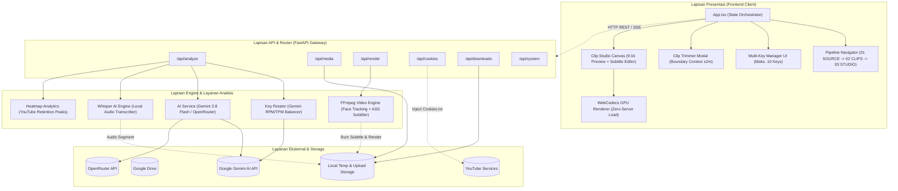
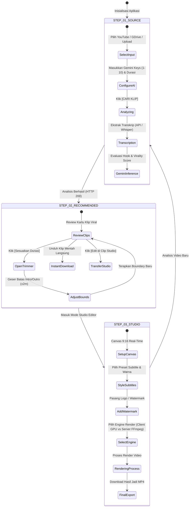
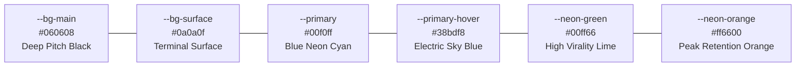

# 🎨 Dokumen Desain Sistem & Antarmuka (System & UI/UX Design) — Cheat Clip PRO

Dokumen ini mendokumentasikan spesifikasi desain arsitektur teknis sistem (*System Design*), kontrak antarmuka API (*Interface Contracts*), serta sistem desain visual UI/UX (*Blue Neon Cyberpunk Design System*) yang diimplementasikan pada **Cheat Clip PRO**.

---

## 🏛️ 1. Arsitektur Desain Sistem (System Architecture)

Cheat Clip PRO mengadopsi arsitektur decoupled hibrida yang memisahkan lapisan antarmuka pengguna (Frontend SPA), gerbang pemrosesan (FastAPI Backend), engine media (FFmpeg + OpenCV), dan layanan inferensi AI eksternal.



---

## 🔄 2. Siklus State & Alur Data Pengguna (Workflow Lifecycle)

Aplikasi dipandu oleh mesin status (*State Machine*) 3 tahap berurutan:



---

## 🔌 3. Spesifikasi Kontrak API Utama

### A. Endpoint Analisis Video (`/api/analyze`)
- **Method**: `POST`
- **Request Body**:
  ```json
  {
    "url": "https://www.youtube.com/watch?v=...",
    "source_type": "youtube",
    "target_duration": "30s",
    "prompt": "cari momen lucu dan edukatif",
    "clip_count": 10,
    "api_provider": "gemini",
    "gemini_api_key": "AIzaSyKey1...,AIzaSyKey2...",
    "language": "id"
  }
  ```
- **Response**: Mengembalikan objek `AnalysisResult` berisi `video_id`, `title`, `duration`, `transcript`, array `clips` lengkap dengan `start_time`, `end_time`, `virality_score`, `hook_sentence`, dan `title_suggestion`.

### B. Endpoint Status Multi-Key Gemini (`/api/gemini-keys/status`)
- **Method**: `GET`
- **Query Params**: `keys` (comma-separated keys)
- **Response**:
  ```json
  {
    "total_keys": 3,
    "active_keys": 3,
    "exhausted_keys": 0,
    "current_index": 0,
    "key_details": [
      { "id": 1, "masked": "AIzaSy...4Zz8", "status": "active", "calls_this_minute": 2 },
      { "id": 2, "masked": "AQ.Ab8...vtDg", "status": "active", "calls_this_minute": 0 }
    ]
  }
  ```

### C. Endpoint Dual Render
1. **Client GPU Render Data (`/api/render/client-data`)**:
   Menyiapkan chunk audio, timing transkrip, dan URL stream video langsung untuk diproses di browser menggunakan WebCodecs API.
2. **Server FFmpeg Render (`/api/render/server`)**:
   Menjalankan pipeline FFmpeg di backend dengan server-sent events (`/api/render/progress/{job_id}`) untuk pelacakan persentase render secara real-time.

---

## 🎨 4. Sistem Desain Visual (Blue Neon Cyberpunk Design System)

Sistem antarmuka Cheat Clip PRO mengusung filosofi **Cyberpunk Precision Brutalism**: permukaan gelap pekat (*pitch black*) berpadu dengan aksen neon berdaya kontras tinggi (*Blue Neon Cyan*), tipografi teknis monospace, dan tata letak padat informasi tanpa ornamen sia-sia.

### A. Palet Warna Utama (Color Tokens)



| Nama Token | Nilai Hex / RGBA | Peruntukan Elemen |
| :--- | :--- | :--- |
| `--bg-main` | `#060608` | Background keseluruhan halaman (body background). |
| `--bg-surface` | `#0a0a0f` | Kartu container, panel formulir, modal background. |
| `--bg-surface-elevated` | `#070c16` | Panel navigasi atas, status card, input container. |
| `--border-color` | `#201e2c` | Border standar antarmuka presisi. |
| `--primary` | `#00f0ff` | Warna identitas utama (Blue Neon Cyan): border aktif, glow focus, logo accent, toggle aktif. |
| `--primary-hover` | `#38bdf8` | Highlight interaktif saat cursor mouse berada di atas elemen utama. |
| `--primary-glow` | `rgba(0, 240, 255, 0.45)` | Efek box-shadow neon bercahaya untuk tombol utama dan status card. |
| `--neon-orange` | `#ff6600` | Kurva heatmap retensi puncak penonton, badge klip terbakar (*hot clip*). |
| `--neon-green` | `#00ff66` | Indikator cookies aktif, virality score tinggi (>85%), tombol sukses unduh. |
| `--accent-red` | `#ff1e27` | Tombol pembersihan cache (*Purge Temp*), notifikasi error, badge limit habis. |
| `--text-primary` | `#f8fafc` | Teks judul, label input, teks utama konten. |
| `--text-secondary` | `#94a3b8` | Deskripsi pendukung, petunjuk fitur, placeholder teks. |
| `--text-muted` | `#64748b` | Timestamp, metadata teknis, copyright, separator baris. |

---

### B. Hirarki Tipografi (Typography Hierarchy)

Cheat Clip PRO memisahkan font secara tegas berdasarkan fungsi data:

1. **Monospace Technical Font (`JetBrains Mono`, `Fira Code`, Consolas)**:
   - Digunakan untuk: Judul logo (`.logo-title`), angka timestamp, persentase virality score, badge status (`.pro-badge`, `.status-pill`), tombol alur tab (`.workflow-tab-btn`), serta kode API Key.
   - Karakter: Memberikan kesan presisi teknis, tajam, dan keterbacaan numerik sempurna.
2. **Sans-Serif Prose Font (`Inter`, system UI)**:
   - Digunakan untuk: Paragraf deskripsi, penjelasan petunjuk (*tooltips*), teks formulir, label bantuan, dan modal dialog.
   - Karakter: Bersih, modern, dan sangat nyaman dibaca dalam waktu lama.
3. **Display Subtitle Fonts (Bebas Neue, Anton, Montserrat, Poppins)**:
   - Digunakan khusus di dalam engine subtitle video vertikal (Tab 03) untuk menghasilkan teks karaoke yang dinamis, tebal, dan mudah dibaca di layar smartphone.

---

### C. Anatomi Komponen UI Utama

#### 1. Header Navigation Bar (Edge-to-Edge Solid Dark)
- Terletak di posisi teratas (`position: sticky`, `z-index: 50`).
- Sisi Kiri: Identitas brand `>_ CHEAT CLIP PRO` dengan indikator titik hijau online.
- Sisi Kanan:
  - Tombol **Cookies Manager** (status `1080p Aktif` / `Atur`).
  - Tombol **Bersihkan Temp** (ikon tempat sampah dengan dialog konfirmasi aman).
  - Tombol **Pembaruan App** (menampilkan dialog cek versi dan git hash).
  - **Language Switcher** (`ID / EN` toggle neon).
  *(Tombol donasi dan footer pihak ketiga telah ditiadakan untuk menjaga estetika clean enterprise).*

#### 2. Multi-Key Manager Card
- Menampilkan status ringkas (misal: `10 Keys Rolling` berwarna hijau neon).
- Mendukung dua mode tampilan:
  - **Single-Key Box**: Input sederhana untuk pengguna kasual.
  - **Multi-Key Manager Modal**: Textarea khusus untuk menempel hingga 10 API Key (dipisahkan koma atau baris baru), lengkap dengan kartu indikator per-kunci (`#1 AQ.Ab8...`, `#2 AIzaSy...`).

#### 3. Clip Trimmer Timeline (Boundary Slider)
- Menampilkan grafik timeline interaktif dengan tiga zona visual:
  - Zona Biru: Klip asli rekomendasi AI.
  - Zona Hijau/Cyan: Penambahan konteks pembuka (*intro context*, hingga -2 menit).
  - Zona Ungu/Cyan: Penambahan konteks penutup (*outro context*, hingga +2 menit).
- Preset instan: `±15d`, `±30d`, `±1m`, dan `Maks 2m`.

#### 4. Dual-Engine Clip Studio Preview
- Rasio aspek 9:16 vertikal dengan border glow neon.
- Kontrol layer: Subtitle styling (Hormozi style, Beast style, Clean minimal), watermark drag position, dan selector engine kompilasi (Client WebCodecs vs Server FFmpeg).

---

## 📱 5. Prinsip Responsivitas & Performa

- **Desktop-First Execution**: Dirancang optimal pada resolusi monitor desktop 1366x768 hingga 4K, dengan tata letak dua kolom pada Tab 01 (Input Form di kiri, Customization di kanan).
- **Graceful Modal Layering**: Seluruh konfigurasi mendalam (Trimmer, Cookies, Multi-Key, App Update) menggunakan modal overlay gelap dengan backdrop blur (`rgba(0, 0, 0, 0.8)`), memastikan pengguna tidak kehilangan konteks alur kerja utama.
- **Hardware Acceleration Friendly**: Menggunakan transformasi CSS 3D (`translateZ(0)`) dan `will-change` pada komponen timeline dan video preview untuk menjamin kelancaran 60 FPS.

---

## 🔗 Referensi Dokumen Terkait
- Latar Belakang & Domain: [`context.md`](./context.md)
- Diagram Arsitektur Komponen: [`diagram.md`](./diagram.md)
- Spesifikasi Kebutuhan Produk: [`PRD_CHEAT_CLIP_PRO.md`](./PRD_CHEAT_CLIP_PRO.md)
- Plan Eksekusi Modular: [`PANDUAN_EKSEKUSI_STRUKTURAL.md`](./PANDUAN_EKSEKUSI_STRUKTURAL.md)
- Panduan Kompilasi Installer: [`installapk.md`](./installapk.md)

