# 🗺️ Diagram Arsitektur Komponen — Cheat Clip PRO

> Diagram visual arsitektur sistem yang memetakan relasi dan aliran kerja antara **Clip Studio Client**, **API Workflows (FastAPI)**, **Analysis Services**, **Media Pipeline**, dan **Layanan Eksternal**.  
> *Generated by [GitDiagram](https://gitdiagram.com/bayunity-brkhstd/clip) for [bayunity-brkhstd/clip](https://github.com/bayunity-brkhstd/clip)*

---

```mermaid
%% Generated by https://gitdiagram.com/bayunity-brkhstd/clip
flowchart TD

subgraph group_client["Clip Studio Client"]
  node_app["Main App<br/>[App.tsx]"]
  node_studio["Clip Studio"]
  node_trimmer["Clip Trimmer"]
  node_client_render["Browser Renderers"]
  node_api_client["API Client<br/>[api.ts]"]
end

subgraph group_api["API Workflows"]
  node_backend["FastAPI App<br/>[main.py]"]
  node_analyze["Video Analysis API<br/>[analyze.py]"]
  node_media_api["Media API<br/>[media.py]"]
  node_render_api["Render API<br/>[render.py]"]
  node_downloads_api["Download API<br/>[downloads.py]"]
  node_cookies_api["Cookie API<br/>[cookies.py]"]
  node_system_api["System API<br/>[system.py]"]
end

subgraph group_analysis["Analysis Services"]
  node_youtube["YouTube Services<br/>[youtube_service.py]"]
  node_gdrive["Google Drive Service<br/>[gdrive_service.py]"]
  node_ai["AI Provider Services<br/>[ai_service.py]"]
  node_openrouter["OpenRouter Service"]
  node_key_rotation["API Key Rotation<br/>[key_rotator.py]"]
  node_text["Transcript Utilities<br/>[text.py]"]
  node_heatmap["Engagement Heatmap<br/>[heatmap.py]"]
end

subgraph group_media["Media Pipeline"]
  node_download["Source Download"]
  node_video_engine["Video Engine<br/>[video_engine.py]"]
  node_render_service["Render Service<br/>[render_service.py]"]
  node_system_service["System Services<br/>[system_service.py]"]
  node_video_store[("Local Media Files<br/>[media.py]")]
  node_finished_videos["Rendered Clips<br/>[render_service.py]"]
end

node_user(("Video Creator"))
node_youtube_external(("YouTube"))
node_drive_external(("Google Drive"))
node_gemini_external(("Google Gemini"))
node_openrouter_external(("OpenRouter"))

node_user -->|"selects source"| node_app
node_app -->|"requests analysis"| node_analyze
node_app -->|"edits clips"| node_studio
node_studio -->|"trims clips"| node_trimmer
node_app -->|"renders locally"| node_client_render
node_app -->|"fetches API"| node_api_client
node_api_client -.->|"sends requests"| node_backend
node_backend -->|"mounts routers"| node_analyze
node_backend -->|"mounts routers"| node_media_api
node_backend -->|"mounts routers"| node_render_api
node_backend -->|"mounts routers"| node_downloads_api
node_backend -->|"mounts routers"| node_cookies_api
node_backend -->|"mounts routers"| node_system_api
node_analyze -->|"gets transcripts"| node_youtube
node_analyze -->|"uses source"| node_gdrive
node_analyze -->|"requests AI analysis"| node_ai
node_analyze -->|"uses provider"| node_openrouter
node_analyze -->|"rotates keys"| node_key_rotation
node_analyze -->|"validates transcript"| node_text
node_analyze -->|"gets engagement data"| node_heatmap
node_youtube -.->|"fetches video data"| node_youtube_external
node_gdrive -.->|"reads video source"| node_drive_external
node_ai -.->|"calls model"| node_gemini_external
node_openrouter -.->|"calls model"| node_openrouter_external
node_media_api -->|"stores uploads"| node_video_store
node_downloads_api -.->|"serves downloads"| node_download
node_render_api -.->|"requests rendering"| node_render_service
node_render_service -.->|"renders media"| node_video_engine
node_video_engine -.->|"produces clips"| node_finished_videos
node_system_api -.->|"requests system actions"| node_system_service
node_download -.->|"downloads source"| node_youtube_external

click node_app "https://github.com/bayunity-brkhstd/clip/blob/main/src/App.tsx"
click node_studio "https://github.com/bayunity-brkhstd/clip/blob/main/src/components/ClipStudioSection.tsx"
click node_trimmer "https://github.com/bayunity-brkhstd/clip/blob/main/src/components/ClipTrimmerModal.tsx"
click node_client_render "https://github.com/bayunity-brkhstd/clip/blob/main/src/services/webcodecsRenderer.ts"
click node_api_client "https://github.com/bayunity-brkhstd/clip/blob/main/src/utils/api.ts"
click node_backend "https://github.com/bayunity-brkhstd/clip/blob/main/backend/main.py"
click node_analyze "https://github.com/bayunity-brkhstd/clip/blob/main/backend/routers/analyze.py"
click node_media_api "https://github.com/bayunity-brkhstd/clip/blob/main/backend/routers/media.py"
click node_render_api "https://github.com/bayunity-brkhstd/clip/blob/main/backend/routers/render.py"
click node_downloads_api "https://github.com/bayunity-brkhstd/clip/blob/main/backend/routers/downloads.py"
click node_cookies_api "https://github.com/bayunity-brkhstd/clip/blob/main/backend/routers/cookies.py"
click node_system_api "https://github.com/bayunity-brkhstd/clip/blob/main/backend/routers/system.py"
click node_youtube "https://github.com/bayunity-brkhstd/clip/blob/main/backend/services/youtube_service.py"
click node_gdrive "https://github.com/bayunity-brkhstd/clip/blob/main/backend/services/gdrive_service.py"
click node_ai "https://github.com/bayunity-brkhstd/clip/blob/main/backend/services/ai_service.py"
click node_openrouter "https://github.com/bayunity-brkhstd/clip/blob/main/backend/services/openrouter_service.py"
click node_key_rotation "https://github.com/bayunity-brkhstd/clip/blob/main/backend/services/key_rotator.py"
click node_text "https://github.com/bayunity-brkhstd/clip/blob/main/backend/utils/text.py"
click node_heatmap "https://github.com/bayunity-brkhstd/clip/blob/main/backend/utils/heatmap.py"
click node_download "https://github.com/bayunity-brkhstd/clip/blob/main/backend/services/download_service.py"
click node_video_engine "https://github.com/bayunity-brkhstd/clip/blob/main/backend/video_engine.py"
click node_render_service "https://github.com/bayunity-brkhstd/clip/blob/main/backend/services/render_service.py"
click node_system_service "https://github.com/bayunity-brkhstd/clip/blob/main/backend/services/system_service.py"
click node_video_store "https://github.com/bayunity-brkhstd/clip/blob/main/backend/routers/media.py"
click node_finished_videos "https://github.com/bayunity-brkhstd/clip/blob/main/backend/services/render_service.py"

classDef toneNeutral fill:#f8fafc,stroke:#334155,stroke-width:1.5px,color:#0f172a
classDef toneBlue fill:#dbeafe,stroke:#2563eb,stroke-width:1.5px,color:#172554
classDef toneAmber fill:#fef3c7,stroke:#d97706,stroke-width:1.5px,color:#78350f
classDef toneMint fill:#dcfce7,stroke:#16a34a,stroke-width:1.5px,color:#14532d
classDef toneRose fill:#ffe4e6,stroke:#e11d48,stroke-width:1.5px,color:#881337
classDef toneIndigo fill:#e0e7ff,stroke:#4f46e5,stroke-width:1.5px,color:#312e81
classDef toneTeal fill:#ccfbf1,stroke:#0f766e,stroke-width:1.5px,color:#134e4a
class node_app,node_studio,node_trimmer,node_client_render,node_api_client toneBlue
class node_backend,node_analyze,node_media_api,node_render_api,node_downloads_api,node_cookies_api,node_system_api toneAmber
class node_youtube,node_gdrive,node_ai,node_openrouter,node_key_rotation,node_text,node_heatmap,node_openrouter_external toneMint
class node_download,node_video_engine,node_render_service,node_system_service,node_video_store,node_finished_videos toneRose
class node_user,node_youtube_external,node_drive_external,node_gemini_external toneIndigo
```

