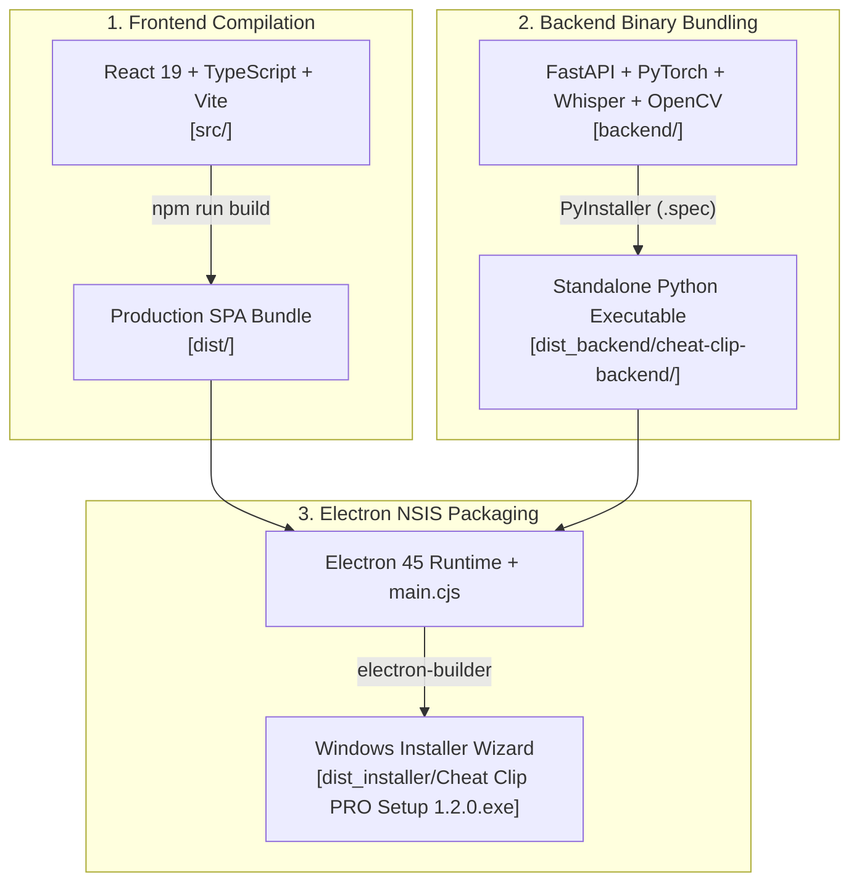

# 🛠️ Panduan Lengkap Build Desktop Installer (.exe) — Cheat Clip PRO

Dokumen ini berisi panduan teknis langkah demi langkah (*step-by-step*) untuk membangun (*build*) paket **Standalone Desktop Installer Windows (`.exe` NSIS Setup Wizard)** Cheat Clip PRO dari kode sumber (*source code*).

Setelah proses build selesai, Anda akan mendapatkan file installer mandiri (misal: `Cheat Clip PRO Setup 1.2.0.exe`) yang siap didistribusikan kepada pengguna akhir tanpa memerlukan instalasi Node.js, Python, FFmpeg, atau Git manual di PC target.

---

## 📋 1. Kebutuhan Sistem & Prerequisites

Sebelum memulai proses kompilasi, pastikan sistem pengembang telah memenuhi spesifikasi berikut:

### A. Perangkat Keras (Hardware)
- **Sistem Operasi**: Windows 10 atau Windows 11 (64-bit Architecture).
- **RAM**: Minimal **8 GB** (Disarankan **16 GB**, karena PyInstaller mem-bundle library AI berukuran masif seperti PyTorch, Whisper, dan OpenCV).
- **Ruang Penyimpanan (Disk)**: Minimal **10 GB ruang kosong** untuk dependensi, cache build, dan file output binary.

### B. Perangkat Lunak (Software Wajib)
1. **Node.js**: Versi **v18.x**, **v20.x**, atau **v22+** (LTS).
   - Verifikasi di terminal:
     ```powershell
     node -v
     npm.cmd -v
     ```
2. **Python**: Versi **3.10 sampai 3.14 (64-bit)**.
   - *PENTING*: Pastikan Python adalah versi 64-bit dan opsi **"Add Python to PATH"** dicentang.
   - Verifikasi di terminal:
     ```powershell
     py -3.14 --version
     # atau
     python --version
     ```
3. **Git for Windows**:
   - Verifikasi di terminal:
     ```powershell
     git --version
     ```

---

## 🏗️ 2. Arsitektur Paket Installer Mandiri

Installer desktop Cheat Clip PRO dibangun dengan menggabungkan 3 lapisan teknologi:



---

## 🧹 3. Prosedur Wajib: Pembersihan File Sampah (Anti Tumpuk-Menumpuk)

> [!CAUTION]
> **PENTING: Jangan melewati langkah pembersihan ini!**  
> Masalah backend tidak terbuka, binary tertimpa stub corrupt 534 KB (`MZP`), port terkunci, atau crash `0x0eedfade` terjadi karena proses lama masih berjalan di latar belakang dan file kompilasi sebelumnya tumpuk-menumpuk.

Sebelum memulai build baru, jalankan pembersihan menyeluruh berikut di PowerShell:

```powershell
# 1. Hentikan seluruh proses backend & aplikasi yang sedang berjalan
Get-CimInstance Win32_Process -Filter "Name like '%cheat%' or Name like '%gcheat%' or Name like '%uvicorn%'" | ForEach-Object { Stop-Process -Id $_.ProcessId -Force -ErrorAction SilentlyContinue }

# 2. Hapus seluruh trash file & folder dist dari build sebelumnya
Remove-Item -Recurse -Force "dist" -ErrorAction SilentlyContinue
Remove-Item -Recurse -Force "dist_backend" -ErrorAction SilentlyContinue
Remove-Item -Recurse -Force "build_pyinstaller" -ErrorAction SilentlyContinue
Remove-Item -Recurse -Force "dist_installer" -ErrorAction SilentlyContinue
```

---

## 🚀 4. Langkah Demi Langkah Eksekusi Build

### Langkah 1: Setup Virtual Environment & Install Dependensi Backend (Python)
Gunakan virtual environment Python 64-bit yang terisolasi:

1. **Buat Virtual Environment:**
   ```powershell
   py -3.14 -m venv venv
   # atau jika menggunakan python bawaan:
   python -m venv venv
   ```

2. **Upgrade Pip & Install Dependensi Backend:**
   ```powershell
   .\venv\Scripts\python.exe -m pip install --upgrade pip
   .\venv\Scripts\pip.exe install -r backend/requirements.txt
   ```

3. **Pastikan PyInstaller Terpasang Bersih:**
   ```powershell
   .\venv\Scripts\pip.exe install --force-reinstall pyinstaller
   ```
   > [!TIP]
   > Memastikan bootloader PyInstaller di `venv\Lib\site-packages\PyInstaller\bootloader\Windows-64bit-intel\run.exe` adalah binary 64-bit asli (berukuran ~311 KB dengan header `MZ`), bukan file 534 KB stub yang corrupt.

---

### Langkah 2: Setup Dependensi Frontend & Electron
Install paket NPM dan pastikan binary resmi Electron telah terunduh:

```powershell
npm.cmd install
```

Verifikasi bahwa executable resmi Electron berada di `node_modules\electron\dist\electron.exe` (berukuran ~249 MB). Jika belum ada, jalankan:
```powershell
node node_modules\electron\install.js
```

---

### Langkah 3: Kompilasi Frontend ke Production Bundle (`dist/`)
Kompilasi kode React 19 + TypeScript dan Vite ke file statis:

```powershell
npm.cmd run build
```
✅ **Hasil**: Folder `dist/` terbentuk berisi `index.html`, icon, dan folder `assets/` (`index-*.js` dan `index-*.css`).

---

### Langkah 4: Kompilasi Backend Python via PyInstaller (`dist_backend/`)
Kompilasi engine FastAPI, yt-dlp, FFmpeg path resolver, PyTorch, Whisper, dan OpenCV menjadi folder binary mandiri:

```powershell
.\venv\Scripts\python.exe -m PyInstaller --noconfirm --clean --onedir --name "cheat-clip-backend" --add-data "backend;backend" --hidden-import "uvicorn" --hidden-import "uvicorn.logging" --hidden-import "uvicorn.loops" --hidden-import "uvicorn.loops.auto" --hidden-import "uvicorn.protocols" --hidden-import "uvicorn.protocols.http" --hidden-import "uvicorn.protocols.http.auto" --hidden-import "uvicorn.lifespan" --hidden-import "uvicorn.lifespan.on" --hidden-import "backend.main" --hidden-import "backend.video_engine" --distpath "./dist_backend" --workpath "./build_pyinstaller" "backend/main.py"
```

> [!NOTE]
> Proses ini memakan waktu **2 hingga 4 menit**. PyInstaller akan mengumpulkan ribuan modul pendukung ke `dist_backend/cheat-clip-backend/`.

✅ **Verifikasi Output Backend**:
Pastikan executable backend telah terbentuk:
```powershell
Get-Item "dist_backend\cheat-clip-backend\cheat-clip-backend.exe"
# Ukuran file harus ~58 MB (binary 64-bit lengkap)
```

---

### Langkah 5: Packaging Standalone NSIS Installer via Electron Builder
Kemas runtime Electron, bundle frontend `dist/`, dan binary backend `dist_backend/`:

```powershell
npm.cmd run electron:dist
```

✅ **Hasil Akhir**:
File installer final akan tersedia di folder `dist_installer/`:
- **Installer Wizard Windows**: [`dist_installer\Cheat Clip PRO Setup 1.2.0.exe`](file:///c:/Users/home/Pictures/New%20folder/clip-main/clip-main/dist_installer/Cheat%20Clip%20PRO%20Setup%201.2.0.exe) (~344 MB).
- **Portable Unpacked Directory**: [`dist_installer\win-unpacked\Cheat Clip PRO.exe`](file:///c:/Users/home/Pictures/New%20folder/clip-main/clip-main/dist_installer/win-unpacked/Cheat%20Clip%20PRO.exe).

---

## ⚡ 5. Cara Cepat: Script Otomatis Sekali Klik

Untuk menghindari kesalahan manual dan tumpukan file lama, gunakan skrip berikut di PowerShell:

```powershell
# 1. Bersihkan proses & cache lama
Get-CimInstance Win32_Process -Filter "Name like '%cheat%' or Name like '%uvicorn%'" | ForEach-Object { Stop-Process -Id $_.ProcessId -Force -ErrorAction SilentlyContinue }
Remove-Item -Recurse -Force dist, dist_backend, build_pyinstaller, dist_installer -ErrorAction SilentlyContinue

# 2. Build Frontend
npm.cmd run build

# 3. Build Backend
.\venv\Scripts\python.exe -m PyInstaller --noconfirm --clean --onedir --name "cheat-clip-backend" --add-data "backend;backend" --hidden-import "uvicorn" --hidden-import "backend.main" --hidden-import "backend.video_engine" --distpath "./dist_backend" --workpath "./build_pyinstaller" "backend/main.py"

# 4. Build Installer
npm.cmd run electron:dist
```

---

## 🛡️ 6. Aturan Teknis Krusial (Guardrails Kompilasi)

1. **Spawn Backend di Electron (`electron/main.cjs`)**:
   Jangan menggunakan `cmd.exe /c start` dengan argumen yang tidak di-quote karena spasi pada nama folder path (seperti `New folder`) akan menyebabkan Windows mencari file terpotong (`Windows cannot find 'Cheat'`). Gunakan `spawn(exePath, ['--port', String(BACKEND_PORT)])` langsung.
2. **FFmpeg Discovery di `backend/video_engine.py`**:
   Selalu pastikan `video_engine.py` mengecualikan direktori FFmpeg yang rusak (misalnya dummy binary 500 KB di `c:\ffmpeg\bin`) dan mengarahkan yt-dlp secara eksplisit (`--ffmpeg-location`) ke build lengkap Gyan / yt-dlp full FFmpeg yang memiliki filter subtitles / `libass`.
3. **Uvicorn Arguments**:
   Pastikan `backend/main.py` mendukung parsing parameter CLI `--port` dan `--host` agar port dinamis yang dikirim Electron diterima dengan benar.
4. **Git Ignore untuk Binary**:
   Folder `dist/`, `dist_backend/`, `build_pyinstaller/`, dan `dist_installer/` wajib ada di `.gitignore` untuk mencegah batas ukuran file GitHub (100 MB).

---

## ❓ 7. Troubleshooting Masalah Umum

### Q1: Muncul pop-up error tanda silang merah dengan tombol "OK" kosong saat aplikasi dibuka?
- **Penyebab**: File template bootloader PyInstaller `run.exe` di environment corrupt atau tertimpa program 32-bit luar.
- **Solusi**:
  1. Hentikan semua proses: `Get-Process -Name "*cheat*" | Stop-Process -Force`.
  2. Install ulang PyInstaller: `.\venv\Scripts\pip.exe install --force-reinstall pyinstaller`.
  3. Hapus folder `dist_backend/` dan `build_pyinstaller/`, lalu kompilasi ulang backend.

### Q2: Download slicing YouTube macet di 15%?
- **Penyebab**: Binary FFmpeg yang dideteksi yt-dlp tidak valid sehingga `--download-sections` gagal.
- **Solusi**: Pastikan Gyan FFmpeg atau yt-dlp FFmpeg terpasang via winget (`winget install Gyan.FFmpeg`) dan backend otomatis mengarahkannya lewat `--ffmpeg-location`.

### Q3: Error "Windows cannot find 'Cheat'" saat membuka aplikasi?
- **Penyebab**: Perintah `start` di CMD memotong spasi pada path direktori program.
- **Solusi**: Pastikan menggunakan spawn langsung di `electron/main.cjs` tanpa perantara `cmd.exe /c start "" "..."`.